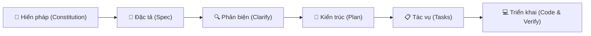

# TỔNG HỢP TOÀN BỘ QUY TRÌNH TẢI VÀ SỬ DỤNG SKILL GITHUB SPEC-KIT

> **Mentor Note:**  
> Chào bạn, tôi là Senior Tech Lead và sẽ đồng hành cùng bạn trong tài liệu này.  
> Trong kỷ nguyên AI phát triển bùng nổ, ranh giới giữa một *"Lập trình viên chuyên nghiệp"* và một *"Thợ gõ prompt ăn may (Vibe Coder)"* nằm ở khả năng kiểm soát kiến trúc và quy trình. **GitHub Spec Kit** chính là chìa khóa vàng giúp bạn chuyển hóa từ việc đoán mò code sang **Spec-Driven Development (SDD - Phát triển phần mềm theo hướng đặc tả)** chuẩn mực quốc tế.

---

## 📑 Mục lục

1. [1. Tác dụng của GitHub Spec Kit](#1-tác-dụng-của-github-spec-kit)
   - [1.1. Bản chất cốt lõi: Vibe Coding vs Spec-Driven Development](#11-bản-chất-cốt-lõi-vibe-coding-vs-spec-driven-development)
   - [1.2. 5 Trụ cột giá trị mà Spec Kit mang lại cho Kỹ sư](#12-5-trụ-cột-giá-trị-mà-spec-kit-mang-lại-cho-kỹ-sư)
2. [2. Cách tải và cài đặt chi tiết](#2-cách-tải-và-cài-đặt-chi-tiết)
   - [2.1. Tư duy kiến trúc & Chuẩn bị môi trường](#21-tư-duy-kiến-trúc--chuẩn-bị-môi-trường)
   - [2.2. Kiểm tra điều kiện tiên quyết (Prerequisites)](#22-kiểm-tra-điều-kiện-tiên-quyết-prerequisites)
   - [2.3. Cài đặt Package Manager hiện đại: `uv`](#23-cài-đặt-package-manager-hiện-đại-uv)
   - [2.4. Cài đặt `specify-cli` từ kho chính thức của GitHub](#24-cài-đặt-specify-cli-từ-kho-chính-thức-của-github)
   - [2.5. Kiểm tra tính toàn vẹn của cài đặt (Health Check)](#25-kiểm-tra-tính-toàn-vẹn-của-cài-đặt-health-check)
3. [3. Cách sử dụng trong thực tế chi tiết (Quy trình thực chiến A - Z)](#3-cách-sử-dụng-trong-thực-tế-chi-tiết-quy-trình-thực-chiến-a---z)
   - [3.1. Giai đoạn 0: Khởi tạo cấu trúc Spec Kit trong dự án (`specify init`)](#31-giai-đoạn-0-khởi-tạo-cấu-trúc-spec-kit-trong-dự-án-specify-init)
   - [3.2. Giai đoạn 1: Xây dựng Hiến pháp dự án (`constitution.md`)](#32-giai-đoạn-1-xây-dựng-hiến-pháp-dự-án-constitutionmd)
   - [3.3. Giai đoạn 2: Tạo Bản đặc tả chức năng (`spec.md`)](#33-giai-đoạn-2-tạo-bản-đặc-tả-chức-năng-specmd)
   - [3.4. Giai đoạn 3: Phản biện và làm rõ yêu cầu (`/speckit.clarify`)](#34-giai-đoạn-3-phản-biện-và-làm-rõ-yêu-cầu-speckitclarify)
   - [3.5. Giai đoạn 4: Thiết kế bản vẽ kiến trúc kỹ thuật (`plan.md`)](#35-giai-đoạn-4-thiết-kế-bản-vẽ-kiến-trúc-kỹ-thuật-planmd)
   - [3.6. Giai đoạn 5: Phân rã công việc thành các tác vụ nguyên tử (`tasks.md`)](#36-giai-đoạn-5-phân-rã-công-việc-thành-các-tác-vụ-nguyên-tử-tasksmd)
   - [3.7. Giai đoạn 6: Triển khai mã nguồn tự động (`/speckit.implement`)](#37-giai-đoạn-6-triển-khai-mã-nguồn-tự-động-speckitimplement)
4. [4. Sổ tay lỗi kinh điển cần tránh (Lessons Learned)](#4-sổ-tay-lỗi-kinh-điển-cần-tránh-lessons-learned)
5. [5. Bảng tra cứu nhanh lệnh GitHub Spec Kit (Cheat Sheet)](#5-bảng-tra-cứu-nhanh-lệnh-github-spec-kit-cheat-sheet)

---

## 1. Tác dụng của GitHub Spec Kit

### 1.1. Bản chất cốt lõi: Vibe Coding vs Spec-Driven Development

Khi lập trình viên tương tác với các AI Coding Agent (GitHub Copilot, Claude Code, Gemini CLI, Cursor...), sai lầm lớn nhất thường mắc phải là **"Vibe Coding"** (lập trình theo cảm xúc):
- Bạn gõ một prompt sơ sài: *"Hãy viết cho tôi hệ thống xác thực người dùng"*.
- AI sẽ tự suy diễn, tự chọn thư viện ngẫu nhiên, tự quyết định cấu trúc database, và sinh ra hàng trăm dòng mã mà chính bạn cũng không kiểm soát nổi.
- **Hệ quả:** Ảo giác mã nguồn (AI Hallucination), trôi dạt ngữ cảnh (Context Drift), bảo mật lỏng lẻo, và khi xảy ra lỗi thì chi phí debug còn đắt hơn tự viết từ đầu.

**GitHub Spec Kit** ra đời để giải quyết tận gốc vấn đề này bằng phương pháp **Spec-Driven Development (SDD)**:
> *"Code không bao giờ được sinh ra trước khi Bản đặc tả (Specification) được kiểm duyệt và phê chuẩn."*



### 1.2. 5 Trụ cột giá trị mà Spec Kit mang lại cho Kỹ sư

1. **Nguồn chân lý duy nhất (Single Source of Truth):** Toàn bộ tri thức, yêu cầu nghiệp vụ, và quyết định kỹ thuật được lưu trữ trong các file Markdown chuẩn (`spec.md`, `plan.md`, `tasks.md`) nằm trực tiếp trong kho Git của bạn.
2. **Tách biệt tuyệt đối giữa "Cái gì/Tại sao" (What/Why) và "Làm như thế nào" (How):** Bạn tập trung làm rõ logic sản phẩm trước khi phải đau đầu lựa chọn database hay framework.
3. **Độc lập nền tảng AI (Agent-Agnostic):** Hỗ trợ chuyển đổi mượt mà giữa các Agent khác nhau (GitHub Copilot, Claude, Gemini, Cursor, Windsurf) mà không làm mất ngữ cảnh dự án.
4. **Kiểm soát phạm vi tác vụ (Atomic Scoping):** Chia nhỏ công việc thành từng bước vi mô, ngăn chặn triệt để tình trạng AI viết lan man vượt quá giới hạn token của context window.
5. **Khả năng kế thừa và tự động hóa:** Có thể tích hợp vào CI/CD pipeline để kiểm tra chất lượng phần mềm trước khi merge code.

[⬆️ Quay lại Mục lục](#mục-lục)

---

## 2. Cách tải và cài đặt chi tiết

### 2.1. Tư duy kiến trúc & Chuẩn bị môi trường

Spec Kit được xây dựng dưới dạng một công cụ dòng lệnh (CLI tool) viết bằng Python có tên là `specify-cli`.  
Trong vai trò Tech Lead, tôi khuyến cáo: **Không sử dụng `pip` toàn cục (global pip)** để tránh tình trạng "Dependency Hell" làm ô nhiễm môi trường Python của hệ điều hành.  
Thay vào đó, chúng ta sẽ sử dụng **`uv`** — công cụ quản lý package và môi trường Python hiện đại nhất hiện nay được viết bằng Rust bởi Astral, chạy nhanh gấp 10-100 lần so với pip và tự động cô lập công cụ vào sandbox riêng biệt (`uv tool`).

---

### 2.2. Kiểm tra điều kiện tiên quyết (Prerequisites)

Trước khi cài đặt, ta cần kiểm tra xem hệ thống đã có `git` hay chưa.

#### ⚡ Lệnh Terminal kiểm tra Git:
```powershell
git --version
```

#### 🔬 Giải phẫu chi tiết lệnh Terminal:
- `git`: Lệnh gọi trình thực thi Git (Version Control System binary).
- `--version`: Cờ (flag) yêu cầu Git in ra phiên bản hiện tại mà không thực hiện bất kỳ thay đổi nào lên hệ thống.

#### 📂 MINH HỌA SỰ TIẾN HÓA CỦA THƯ MỤC:
> Lệnh này chỉ thực hiện tác vụ đọc thông tin (read-only command), không làm thay đổi hay tạo mới bất kỳ file/thư mục nào trong workspace.
```text
(Workspace không thay đổi cấu trúc thư mục)
```

---

### 2.3. Cài đặt Package Manager hiện đại: `uv`

Nếu máy tính của bạn chưa có `uv`, hãy cài đặt phiên bản chính thức bằng PowerShell.

#### ⚡ Lệnh Terminal cài đặt `uv`:
```powershell
powershell -ExecutionPolicy ByPass -c "irm https://astral.sh/uv/install.ps1 | iex"
```

#### 🔬 Giải phẫu chi tiết lệnh Terminal:
- `powershell`: Khởi chạy một phiên thực thi Windows PowerShell mới.
- `-ExecutionPolicy ByPass`: Tạm thời bỏ qua chính sách hạn chế thực thi script của Windows (Execution Policy) chỉ cho phiên làm việc này, đảm bảo script cài đặt không bị chặn bởi bảo mật của hệ thống.
- `-c`: Viết tắt của `-Command`, báo cho PowerShell biết tham số tiếp theo là một chuỗi lệnh cần chạy.
- `"irm https://astral.sh/uv/install.ps1 | iex"`:
  - `irm`: Bí danh (alias) của cmdlet `Invoke-RestMethod` trong PowerShell, dùng để gửi request HTTP GET và tải toàn bộ nội dung script cài đặt từ URL `https://astral.sh/uv/install.ps1`.
  - `|`: Ký tự đường ống (pipe), chuyển toàn bộ mã script vừa tải về sang cho lệnh phía sau.
  - `iex`: Bí danh (alias) của cmdlet `Invoke-Expression`, nhận chuỗi code được chuyển qua pipeline và thực thi ngay lập tức trong bộ nhớ.

#### 📂 MINH HỌA SỰ TIẾN HÓA CỦA THƯ MỤC:
```text
C:\Users\<Tên_User>\
└── 📁 .cargo/ (hoặc .local/bin/)
    ├── 📁 bin/
    │   ├── 📄 uv.exe         <-- [MỚI TẠO chính xác từ lệnh powershell -c "irm..."] Binary điều hành uv
    │   └── 📄 uvx.exe        <-- [MỚI TẠO] Binary dùng để chạy tức thì các package độc lập
```

---

### 2.4. Cài đặt `specify-cli` từ kho chính thức của GitHub

Bây giờ ta dùng `uv tool` để tải và đóng gói Spec Kit vào môi trường độc lập an toàn.

#### ⚡ Lệnh Terminal cài đặt Spec Kit:
```powershell
uv tool install specify-cli --from git+https://github.com/github/spec-kit.git
```

#### 🔬 Giải phẫu chi tiết lệnh Terminal:
- `uv`: Gọi trình quản lý môi trường và package `uv`.
- `tool`: Subcommand của `uv` chuyên dùng để quản lý các ứng dụng CLI độc lập toàn cục (tương đương với `pipx`).
- `install`: Chỉ thị yêu cầu tải, build wheel và cài đặt package.
- `specify-cli`: Tên chính thức của gói phần mềm Spec Kit CLI.
- `--from`: Cờ chỉ định nguồn gốc của package (source target) thay vì tải từ kho PyPI mặc định.
- `git+https://github.com/github/spec-kit.git`: Chuỗi URI định dạng giao thức Git qua HTTPS, báo hiệu cho `uv` clone trực tiếp commit mới nhất từ repository của GitHub về để biên dịch.

#### 📂 MINH HỌA SỰ TIẾN HÓA CỦA THƯ MỤC:
```text
C:\Users\<Tên_User>\
├── 📁 .local/share/uv/tools/
│   └── 📁 specify-cli/       <-- [MỚI TẠO chính xác từ lệnh uv tool install] Virtualenv độc lập chứa runtime của Spec Kit
└── 📁 .cargo/bin/
    └── 📄 specify.exe        <-- [MỚI TẠO] File liên kết thực thi (shim binary) cho phép gõ lệnh 'specify' từ bất kỳ đâu
```

---

### 2.5. Kiểm tra tính toàn vẹn của cài đặt (Health Check)

Sau khi cài đặt xong, một kỹ sư giỏi luôn kiểm tra lại (Sanity Check) để đảm bảo công cụ đã sẵn sàng hoạt động.

#### ⚡ Lệnh Terminal kiểm tra:
```powershell
specify --version
specify check
```

#### 🔬 Giải phẫu chi tiết lệnh Terminal:
- `specify`: Tên lệnh điều khiển chính của Spec Kit CLI.
- `--version`: Cờ in ra phiên bản cài đặt hiện hành của Spec Kit.
- `check`: Lệnh con (subcommand) chuyên biệt của Spec Kit, dùng để quét toàn diện môi trường máy tính của bạn (kiểm tra Git, Python runtime, kết nối mạng và các AI agent đã được cài đặt trong hệ thống).

#### 📂 MINH HỌA SỰ TIẾN HÓA CỦA THƯ MỤC:
> Tương tự các lệnh đọc, đây là lệnh chẩn đoán (diagnostic command) và không làm thay đổi cấu trúc workspace.
```text
(Workspace không thay đổi cấu trúc thư mục)
```

[⬆️ Quay lại Mục lục](#mục-lục)

---

## 3. Cách sử dụng trong thực tế chi tiết (Quy trình thực chiến A - Z)

Để bạn hiểu thấu đáo bản chất của Spec Kit, chúng ta sẽ thực hành trực tiếp một dự án mẫu thực tế:  
**Xây dựng Module Xác thực người dùng (User Authentication Service) với JWT và Argon2id**.

---

### 3.1. Giai đoạn 0: Khởi tạo cấu trúc Spec Kit trong dự án (`specify init`)

#### 🧠 Tư duy logic:
Tại sao ta phải chạy lệnh `init`?  
AI coding agent không thể thông minh nếu không có "mỏ neo ngữ cảnh" (context anchors). Lệnh `specify init` sẽ thiết lập toàn bộ bộ khung quản trị, các template tài liệu chuẩn và các bộ prompt chuyên dụng cho AI trong dự án của bạn.

#### ⚡ Lệnh Terminal khởi tạo:
```powershell
specify init . --integration agy --ignore-agent-tools --script ps
```
*(Nếu bạn dùng Copilot, Claude Code, hay Cursor, bạn có thể thay thế giá trị cờ `--integration copilot` hoặc `--integration claude`)*.

#### 🔬 Giải phẫu chi tiết lệnh Terminal:
- `specify`: Gọi CLI của Spec Kit.
- `init`: Lệnh khởi tạo cấu trúc Spec-Driven Development vào dự án.
- `.`: Đại diện cho thư mục làm việc hiện tại (Current Working Directory).
- `--integration`: Cờ chỉ định loại AI Coding Agent tích hợp (trong Spec Kit phiên bản mới chuẩn hóa thành `--integration` thay vì `--ai`). Tham số truyền vào là `agy` (Antigravity).
- `--ignore-agent-tools`: Bỏ qua bước kiểm tra binary CLI cục bộ trong PATH hệ thống (đặc biệt hữu ích khi bạn đang sử dụng Antigravity IDE hoặc extension giao diện trực quan).
- `--script ps`: Chỉ định bộ script tự động hóa được sinh ra dưới định dạng PowerShell script (`.ps1`) tối ưu cho môi trường Windows.

#### 📂 MINH HỌA SỰ TIẾN HÓA CỦA THƯ MỤC:
```text
agent-skills/
├── 📁 .github/
│   └── 📁 prompts/           <-- [MỚI TẠO chính xác từ lệnh specify init . --integration copilot]
│       ├── 📄 speckit.constitution.prompt.md
│       ├── 📄 speckit.specify.prompt.md
│       ├── 📄 speckit.clarify.prompt.md
│       ├── 📄 speckit.plan.prompt.md
│       ├── 📄 speckit.tasks.prompt.md
│       └── 📄 speckit.implement.prompt.md
└── 📁 .specify/              <-- [MỚI TẠO chính xác từ lệnh specify init] Cội nguồn tri thức của dự án
    ├── 📁 memory/
    │   └── 📄 constitution.md <-- [MỚI TẠO] File chứa các quy tắc kiến trúc bất biến
    ├── 📁 templates/         <-- [MỚI TẠO] Khung mẫu cho spec, plan, tasks
    │   ├── 📄 spec-template.md
    │   ├── 📄 plan-template.md
    │   └── 📄 tasks-template.md
    └── 📁 scripts/           <-- [MỚI TẠO] Script tự động hóa hỗ trợ Agent
```

---

### 3.2. Giai đoạn 1: Xây dựng Hiến pháp dự án (`constitution.md`)

#### 🧠 Tư duy logic:
Tại sao Hiến pháp (Constitution) lại quan trọng nhất?  
Khi không có hiến pháp, AI sẽ tự ý sử dụng bất kỳ thư viện nào nó thích (ví dụ: băm mật khẩu bằng MD5 hoặc SHA1 lỗi thời thay vì Argon2id, dùng `any` bừa bãi trong TypeScript). Hiến pháp là tập hợp các **nguyên tắc bất di bất dịch** mà mọi dòng code sau này bắt buộc phải tuân theo.

#### 📝 Nội dung thực tế cấu hình `.specify/memory/constitution.md`:
Mở file `.specify/memory/constitution.md` và thiết lập các điều khoản kỹ thuật:

```markdown
# HIẾN PHÁP KIẾN TRÚC DỰ ÁN (PROJECT CONSTITUTION)

## Điều 1: Tiêu chuẩn Bảo mật (Security Standards)
- Mọi mật khẩu người dùng BẮT BUỘC phải được băm bằng thuật toán Argon2id với thông số memory cost tối thiểu 64MB. Tuyệt đối nghiêm cấm MD5, SHA-256 thuần hoặc bcrypt cũ.
- Sử dụng Access Token chuẩn JWT (hạn dùng 15 phút) kết hợp Refresh Token (hạn dùng 7 ngày, lưu vào HttpOnly Cookie).

## Điều 2: Tiêu chuẩn Mã nguồn & Ngôn ngữ
- Sử dụng TypeScript với cờ `strict: true`. Nghiêm cấm sử dụng kiểu `any`.
- Áp dụng kiến trúc Clean Architecture: Tách biệt rõ ràng Controller, Service, Repository.

## Điều 3: Tiêu chuẩn Kiểm thử (Quality Assurance)
- Mọi logic nghiệp vụ trong tầng Service phải đạt độ bao phủ kiểm thử (Test Coverage) tối thiểu 85%.
- Bắt buộc viết Unit Test trước khi coi một tác vụ là hoàn thành.
```

#### 📂 MINH HỌA SỰ TIẾN HÓA CỦA THƯ MỤC:
```text
.specify/
└── memory/
    └── 📄 constitution.md    <-- [CẬP NHẬT] Đã điền 3 điều khoản cốt lõi về bảo mật, kiến trúc và kiểm thử
```

---

### 3.3. Giai đoạn 2: Tạo Bản đặc tả chức năng (`spec.md`)

#### 🧠 Tư duy logic:
Tại sao ở bước này KHÔNG được phép nhắc đến cơ sở dữ liệu hay framework?  
Bản đặc tả chức năng (`spec.md`) chỉ tập trung vào góc nhìn của **Người dùng (User Persona)** và **Hành vi nghiệp vụ (Business Requirements)**. Nếu bạn vội vàng đưa Postgres, MongoDB hay Redis vào đây, bạn sẽ làm lu mờ logic nghiệp vụ cốt lõi và giới hạn khả năng tối ưu kiến trúc ở các bước sau.

#### ⚡ Hành động trong AI Agent Chat (Slash Command):
Gõ lệnh sau vào cửa sổ chat với AI:
```text
/speckit.specify "Xây dựng tính năng Đăng ký và Đăng nhập cho người dùng. Người dùng đăng ký bằng email và mật khẩu hợp lệ (tối thiểu 8 ký tự, có chữ hoa, số và ký tự đặc biệt). Hệ thống gửi mã xác thực qua email. Khi đăng nhập thành công, hệ thống trả về thông tin người dùng và phiên đăng nhập."
```

#### 🔬 Cơ chế hoạt động của lệnh `/speckit.specify`:
Lệnh này nạp template `spec-template.md`, kích hoạt AI phân tích câu prompt của bạn, đối chiếu với `constitution.md`, sau đó tự động tạo ra một thư mục feature có đánh số thứ tự trong `specs/`.

#### 📂 MINH HỌA SỰ TIẾN HÓA CỦA THƯ MỤC:
```text
agent-skills/
└── 📁 specs/                 <-- [MỚI TẠO chính xác từ lệnh /speckit.specify] Thư mục chứa các đặc tả tính năng
    └── 📁 001-user-auth/     <-- [MỚI TẠO] Mã định danh tính năng 001
        └── 📄 spec.md        <-- [MỚI TẠO] Chứa User Stories, Acceptance Criteria, Edge Cases
```

---

### 3.4. Giai đoạn 3: Phản biện và làm rõ yêu cầu (`/speckit.clarify`)

#### 🧠 Tư duy logic:
Tại sao cần bước phản biện này?  
Con người khi viết yêu cầu luôn có những "điểm mù" (blind spots). Ví dụ: *Chuyện gì xảy ra nếu người dùng cố tình spam đăng nhập 100 lần trong 1 giây? Mã xác thực email tồn tại trong bao lâu?*  
Lệnh `/speckit.clarify` biến AI thành một Senior Tech Lead đóng vai trò phản biện, chỉ ra các lỗ hổng logic trước khi bắt tay vào code.

#### ⚡ Hành động trong AI Agent Chat:
```text
/speckit.clarify
```

#### 🔬 Cơ chế hoạt động của lệnh `/speckit.clarify`:
AI sẽ đọc `specs/001-user-auth/spec.md`, tìm các điểm thiếu sót, đặt câu hỏi cho bạn (ví dụ: cơ chế Rate Limiting, thời gian sống của OTP). Sau khi bạn trả lời, AI sẽ bổ sung trực tiếp các điều kiện biên (Edge Cases) đó vào `spec.md`.

#### 📂 MINH HỌA SỰ TIẾN HÓA CỦA THƯ MỤC:
```text
specs/
└── 001-user-auth/
    └── 📄 spec.md            <-- [CẬP NHẬT chính xác từ lệnh /speckit.clarify] Bổ sung phần 4: Edge Cases & Rate Limiting
```

---

### 3.5. Giai đoạn 4: Thiết kế bản vẽ kiến trúc kỹ thuật (`plan.md`)

#### 🧠 Tư duy logic:
Tại sao đến tận bây giờ ta mới chọn công nghệ?  
Khi yêu cầu nghiệp vụ và các trường hợp biên đã hoàn toàn sáng tỏ, việc chọn Tech Stack mới chính xác 100%, không bị thừa thãi (Over-engineering) hay thiếu hụt công nghệ. Đây là lúc biến "What" thành "How".

#### ⚡ Hành động trong AI Agent Chat:
```text
/speckit.plan "Sử dụng Node.js, Express, TypeScript, Prisma ORM với PostgreSQL, và Redis để cache token/rate limiting"
```

#### 🔬 Cơ chế hoạt động của lệnh `/speckit.plan`:
AI sẽ đối chiếu `spec.md` với `constitution.md`, sau đó lập ra bản thiết kế chi tiết:
- Cấu trúc các bảng dữ liệu (Data Schema).
- Danh sách Endpoint API (Request/Response contracts).
- Phân chia tầng kiến trúc (Controller, Service, Repository).

#### 📂 MINH HỌA SỰ TIẾN HÓA CỦA THƯ MỤC:
```text
specs/
└── 001-user-auth/
    ├── 📄 spec.md
    └── 📄 plan.md            <-- [MỚI TẠO chính xác từ lệnh /speckit.plan] Bản thiết kế hệ thống chi tiết
```

---

### 3.6. Giai đoạn 5: Phân rã công việc thành các tác vụ nguyên tử (`tasks.md`)

#### 🧠 Tư duy logic:
Tại sao không để AI code luôn cả tính năng một lúc?  
Cửa sổ ngữ cảnh (Context Window) của LLM có hạn. Nếu yêu cầu AI làm toàn bộ hệ thống đăng nhập cùng lúc, nó sẽ bắt đầu "cắt xén" code (ví dụ: `// TODO: implement later`), bỏ qua kiểm thử, hoặc viết code ẩu.  
Spec Kit bắt buộc phải chia nhỏ thành các **Tác vụ nguyên tử (Atomic Tasks)**: mỗi task chỉ làm đúng 1 việc, có file đích cụ thể và có bài test kiểm chứng đi kèm.

#### ⚡ Hành động trong AI Agent Chat:
```text
/speckit.tasks
```

#### 🔬 Cơ chế hoạt động của lệnh `/speckit.tasks`:
AI tự động bóc tách từ `plan.md` thành một danh sách công việc có thứ tự phụ thuộc (Dependencies Order):
- `[ ] Task 001`: Cài đặt dependencies (Argon2, jsonwebtoken, prisma).
- `[ ] Task 002`: Tạo Prisma schema cho User và Migration DB.
- `[ ] Task 003`: Viết AuthService với hàm băm Argon2id và Unit Test.
- `[ ] Task 004`: Viết Controller và Route cho API `/api/v1/auth/register`.

#### 📂 MINH HỌA SỰ TIẾN HÓA CỦA THƯ MỤC:
```text
specs/
└── 001-user-auth/
    ├── 📄 spec.md
    ├── 📄 plan.md
    └── 📄 tasks.md           <-- [MỚI TẠO chính xác từ lệnh /speckit.tasks] Danh sách các check-list tác vụ nguyên tử
```

---

### 3.7. Giai đoạn 6: Triển khai mã nguồn tự động (`/speckit.implement`)

#### 🧠 Tư duy logic:
Tại sao ở bước này AI viết code ít khi bị lỗi?  
Bởi vì AI không cần suy đoán bất cứ điều gì nữa:
1. Luật chơi đã có ở `constitution.md`.
2. Nghiệp vụ đã chốt ở `spec.md`.
3. Bản vẽ kỹ thuật đã rõ ở `plan.md`.
4. Các bước đi từng centimet đã có ở `tasks.md`.  
Nhiệm vụ của AI lúc này thuần túy là thực thi chính xác từng task một, chạy test, đánh dấu `[x]` và chuyển sang task tiếp theo.

#### ⚡ Hành động trong AI Agent Chat:
```text
/speckit.implement
```

#### 🔬 Cơ chế hoạt động của lệnh `/speckit.implement`:
Agent đọc từng task trong `tasks.md`, tạo mã nguồn tương ứng, chạy unit test kiểm chứng; nếu test pass thì tick `[x]`, nếu fail thì tự sửa đến khi pass mới chuyển task.

#### 📂 MINH HỌA SỰ TIẾN HÓA CỦA THƯ MỤC:
```text
agent-skills/
├── 📁 src/                   <-- [MỚI TẠO chính xác từ quá trình /speckit.implement]
│   ├── 📁 controllers/
│   │   └── 📄 auth.controller.ts
│   ├── 📁 services/
│   │   └── 📄 auth.service.ts
│   └── 📁 repositories/
│       └── 📄 user.repository.ts
├── 📁 tests/                 <-- [MỚI TẠO] Bộ kiểm thử tự động
│   └── 📄 auth.service.spec.ts
└── 📁 specs/
    └── 001-user-auth/
        └── 📄 tasks.md       <-- [CẬP NHẬT] Toàn bộ các task đã chuyển sang trạng thái [x] hoàn thành
```

[⬆️ Quay lại Mục lục](#mục-lục)

---

## 4. Sổ tay lỗi kinh điển cần tránh (Lessons Learned)

Dưới đây là 5 sai lầm nghiêm trọng mà các lập trình viên thường mắc phải khi ứng dụng Spec Kit, kèm theo giải pháp khắc phục từ kinh nghiệm Tech Lead:

### ⚠️ Sai lầm 1: Để trống hoặc viết sơ sài `constitution.md`
- **Hiện tượng:** Lập trình viên bỏ qua bước thiết lập hiến pháp hoặc chỉ ghi 1-2 dòng chung chung.
- **Hậu quả:** AI tự do sinh mã theo thói quen ngẫu nhiên từ tập dữ liệu huấn luyện của nó, dẫn đến việc dùng thư viện không đồng nhất (chỗ dùng `axios`, chỗ dùng `fetch`), vi phạm tiêu chuẩn bảo mật của công ty.
- **Giải pháp:** Luôn xác định rõ ràng tối thiểu 3 yếu tố trong hiến pháp: (1) Chuẩn bảo mật, (2) Phong cách viết mã (Coding Style/Linter), (3) Chỉ tiêu kiểm thử (Test Coverage).

### ⚠️ Sai lầm 2: Trộn lẫn "What" và "How" trong `spec.md`
- **Hiện tượng:** Ngay trong file đặc tả `spec.md` đã viết: *"Tạo bảng users trong PostgreSQL có cột password dạng varchar"*.
- **Hậu quả:** Phá vỡ tính linh hoạt của thiết kế. Nếu sau này hệ thống cần chuyển sang lưu trữ phân tán hoặc NoSQL, bạn sẽ phải viết lại toàn bộ bản đặc tả.
- **Giải pháp:** `spec.md` chỉ nói về con người và nghiệp vụ: *"Người dùng cần được bảo vệ thông tin đăng nhập và có thể lấy lại mật khẩu qua email"*. Mọi chi tiết kỹ thuật phải đẩy sang `plan.md`.

### ⚠️ Sai lầm 3: Phân rã tác vụ quá lớn trong `tasks.md` (Monolithic Tasks)
- **Hiện tượng:** Viết một task kiểu: *"Task 01: Xây dựng toàn bộ hệ thống API xác thực và giao diện đăng nhập"*.
- **Hậu quả:** AI bị quá tải bộ nhớ ngữ cảnh (Context Overflow), bắt đầu cắt xén code, sinh mã không hoàn chỉnh và không thể viết unit test đầy đủ.
- **Giải pháp:** Tuân thủ nguyên tắc **Atomic Task**: Mỗi task chỉ giải quyết một file hoặc một hàm cụ thể, dung lượng thay đổi dưới 100 dòng mã và có thể kiểm thử độc lập được ngay lập tức.

### ⚠️ Sai lầm 4: Sửa code trực tiếp bằng tay mà không cập nhật tài liệu (Documentation Drift)
- **Hiện tượng:** Khi phát hiện bug trong lúc implement, lập trình viên nhảy vào sửa code thẳng trên IDE mà không cập nhật lại `spec.md` hay `plan.md`.
- **Hậu quả:** "Nguồn chân lý duy nhất" bị phá vỡ. Ở các lần prompt tiếp theo, AI sẽ đọc tài liệu cũ và sinh mã xung đột với những gì bạn vừa sửa bằng tay.
- **Giải pháp:** Nếu có thay đổi về kiến trúc hoặc logic, hãy cập nhật `plan.md`/`spec.md` trước, sau đó yêu cầu AI đồng bộ hóa lại code.

### ⚠️ Sai lầm 5: Bỏ qua bước `/speckit.clarify`
- **Hiện tượng:** Đi thẳng từ `spec.md` sang `plan.md` vì nghĩ rằng yêu cầu của mình đã đủ rõ.
- **Hậu quả:** Bỏ sót các kịch bản lỗi nghiêm trọng (ví dụ: mất kết nối mạng khi đang gửi OTP, tài khoản bị khóa do đăng nhập sai nhiều lần). Đến khi triển khai thực tế mới phát hiện ra thì cấu trúc database đã bị cố định, rất khó sửa.
- **Giải pháp:** Luôn để AI chất vấn ngược lại bạn qua bước clarify ít nhất 1 vòng trước khi chốt kiến trúc.

[⬆️ Quay lại Mục lục](#mục-lục)

---

## 5. Bảng tra cứu nhanh lệnh GitHub Spec Kit (Cheat Sheet)

### 📌 Bảng 1: Các lệnh Terminal CLI (`specify-cli`)

| Lệnh Terminal | Giải thích tham số cốt lõi | Mục đích sử dụng | Vị trí ảnh hưởng |
| :--- | :--- | :--- | :--- |
| `specify init <path>` | `<path>`: Đường dẫn dự án (ví dụ `.` cho thư mục hiện tại) | Khởi tạo cấu trúc Spec Kit cho dự án | Tạo thư mục `.specify/` và các template mẫu |
| `specify init . --integration <agent>` | `--integration`: Tên agent (`agy`, `copilot`, `claude`, `cursor`) | Khởi tạo kèm bộ prompt/skills chuyên biệt cho AI cụ thể | Tạo thư mục cấu hình của agent (ví dụ `.agents/skills/` hoặc `.github/prompts/`) |
| `specify check` | Không có tham số | Kiểm tra tính tương thích và sức khỏe môi trường | Quét kiểm tra Git, Python, Shell và các Agent |
| `specify version` | Không có tham số | Hiển thị phiên bản hiện hành của Spec Kit | Đọc thông tin từ binary của CLI |

---

### 📌 Bảng 2: Các lệnh tương tác với AI Agent (Slash Commands)

| Lệnh Slash Command | Giai đoạn thực hiện | Đầu vào yêu cầu | Sản phẩm đầu ra (Artifacts) |
| :--- | :--- | :--- | :--- |
| `/speckit.constitution` | **Giai đoạn 1** | Các nguyên tắc kiến trúc & bảo mật của dự án | Cập nhật `.specify/memory/constitution.md` |
| `/speckit.specify` | **Giai đoạn 2** | Mô tả tính năng ở mức ngôn ngữ tự nhiên | Tạo `specs/NNN-<feature>/spec.md` |
| `/speckit.clarify` | **Giai đoạn 3** | Trả lời các câu hỏi phản biện của AI | Cập nhật các Edge Cases vào `spec.md` |
| `/speckit.plan` | **Giai đoạn 4** | Lựa chọn Tech Stack & Architecture pattern | Tạo `specs/NNN-<feature>/plan.md` |
| `/speckit.tasks` | **Giai đoạn 5** | Phân tích từ `plan.md` và `spec.md` | Tạo danh sách tác vụ `specs/NNN-<feature>/tasks.md` |
| `/speckit.analyze` | **Giai đoạn 5.5** | Toàn bộ các file trong thư mục `specs/NNN/` | Báo cáo kiểm tra tính nhất quán giữa spec và plan |
| `/speckit.implement` | **Giai đoạn 6** | Tự động đọc tuần tự từ `tasks.md` | Tạo mã nguồn trong `src/`, chạy test và tích `[x]` |

---

### 📌 Bảng 3: Vòng đời tệp tin trong một vòng lặp tính năng (Feature Lifecycle)

```text
Ý tưởng ban đầu (Idea)
        │
        ▼ (chạy /speckit.specify)
┌─────────────────────────────────┐
│   specs/001-feature/spec.md     │ <--- Xác định "CÁI GÌ" & "TẠI SAO"
└─────────────────────────────────┘
        │
        ▼ (chạy /speckit.clarify)
┌─────────────────────────────────┐
│   specs/001-feature/spec.md     │ <--- Bổ sung Edge Cases & Security
└─────────────────────────────────┘
        │
        ▼ (chạy /speckit.plan)
┌─────────────────────────────────┐
│   specs/001-feature/plan.md     │ <--- Xác định "LÀM NHƯ THẾ NÀO" (Tech stack, DB)
└─────────────────────────────────┘
        │
        ▼ (chạy /speckit.tasks)
┌─────────────────────────────────┐
│   specs/001-feature/tasks.md    │ <--- Bóc tách thành các Atomic Tasks [ ]
└─────────────────────────────────┘
        │
        ▼ (chạy /speckit.implement)
┌─────────────────────────────────┐
│   Mã nguồn (src/) & Tests       │ <--- Code hoàn chỉnh, Tasks chuyển sang [x]
└─────────────────────────────────┘
```

[⬆️ Quay lại Mục lục](#mục-lục)

