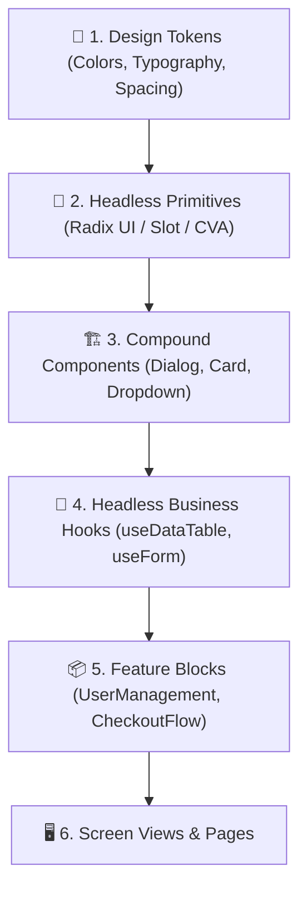

# TỔNG HỢP TOÀN BỘ QUY TRÌNH TẢI VÀ SỬ DỤNG SKILL REACT-UI-MASTER

> **Mentor Note:**  
> Chào bạn, tôi là Senior Tech Lead và sẽ đồng hành cùng bạn trong lộ trình làm chủ kỹ năng kiến trúc giao diện người dùng hiện đại.  
> Trong kỷ nguyên AI hỗ trợ lập trình, việc yêu cầu AI viết một nút bấm hay một form đăng nhập chỉ mất vài giây. Tuy nhiên, sự khác biệt sống còn giữa một **"Vibe Coder"** (lập trình viên phụ thuộc vào may rủi của AI prompt, sinh ra mớ mã nguồn chắp vá, tái render vô tội vạ, phá vỡ khả năng tiếp cận) và một **"Senior Frontend Architect"** nằm ở khả năng thiết lập **Hệ thống thiết kế (Design System)**, chuẩn mực **Composition Pattern**, an toàn kiểu dữ liệu tuyệt đối (**Strict Type-Safety**), và khả năng tiếp cận phổ quát (**Accessibility - a11y**).  
> **Skill `react-ui-master`** là bộ quy chuẩn công nghiệp và hướng dẫn chuyên gia giúp định hình tư duy của cả bạn lẫn AI Coding Agent, biến các dòng code giao diện thành những khối Lego vững chắc, tối ưu và chuẩn mực cấp doanh nghiệp.

---

## 📑 Mục lục

1. [1. Tác dụng của react-ui-master](#1-tác-dụng-của-react-ui-master)
   - [1.1. Bản chất cốt lõi: Vibe Coding UI vs Senior UI Architecture](#11-bản-chất-cốt-lõi-vibe-coding-ui-vs-senior-ui-architecture)
   - [1.2. 5 Trụ cột kiến trúc mà react-ui-master thiết lập](#12-5-trụ-cột-kiến-trúc-mà-react-ui-master-thiết-lập)
   - [1.3. Cấu trúc nội tại của Agent Skill react-ui-master](#13-cấu-trúc-nội-tại-của-agent-skill-react-ui-master)
2. [2. Cách tải chi tiết](#2-cách-tải-chi-tiết)
   - [2.1. Tư duy kiến trúc & Chuẩn bị môi trường](#21-tư-duy-kiến-trúc--chuẩn-bị-môi-trường)
   - [2.2. Kiểm tra điều kiện tiên quyết (Prerequisites)](#22-kiểm-tra-điều-kiện-tiên-quyết-prerequisites)
   - [2.3. Khởi tạo dự án React + TypeScript hiện đại bằng Vite](#23-khởi-tạo-dự-án-react--typescript-hiện-đại-bằng-vite)
   - [2.4. Cài đặt hệ sinh thái UI Master (Tailwind CSS, CVA, Radix Primitives, Lucide)](#24-cài-đặt-hệ-sinh-thái-ui-master-tailwind-css-cva-radix-primitives-lucide)
   - [2.5. Tải và tích hợp Agent Skill `react-ui-master` vào dự án](#25-tải-và-tích-hợp-agent-skill-react-ui-master-vào-dự-án)
   - [2.6. Kiểm tra tính toàn vẹn của cài đặt (Health Check)](#26-kiểm-tra-tính-toàn-vẹn-của-cài-đặt-health-check)
3. [3. Cách sử dụng trong thực tế chi tiết](#3-cách-sử-dụng-trong-thực-tế-chi-tiết)
   - [3.1. Giai đoạn 0: Thiết lập Hạ tầng Design Tokens và Utility `cn()`](#31-giai-đoạn-0-thiết-lập-hạ-tầng-design-tokens-và-utility-cn)
   - [3.2. Giai đoạn 1: Xây dựng Atomic Primitive Component với CVA & Polymorphism (`Button`)](#32-giai-đoạn-1-xây-dựng-atomic-primitive-component-với-cva--polymorphism-button)
   - [3.3. Giai đoạn 2: Xây dựng Compound Component phức tạp với WAI-ARIA & Focus Trap (`Dialog/Modal`)](#33-giai-đoạn-2-xây-dựng-compound-component-phức-tạp-với-wai-aria--focus-trap-dialogmodal)
   - [3.4. Giai đoạn 3: Phân tách tuyệt đối Presentational UI và State qua Custom Hook (`DataTable`)](#34-giai-đoạn-3-phân-tách-tuyệt-đối-presentational-ui-và-state-qua-custom-hook-datatable)
   - [3.5. Giai đoạn 4: Tối ưu hóa hiệu năng & Vệ sinh biên độ Render (Render Hygiene)](#35-giai-đoạn-4-tối-ưu-hóa-hiệu-năng--vệ-sinh-biên-độ-render-render-hygiene)
   - [3.6. Giai đoạn 5: Tự động hóa kiểm thử Component & Accessibility (Vitest + axe-core)](#36-giai-đoạn-5-tự-động-hóa-kiểm-thử-component--accessibility-vitest--axe-core)
4. [4. Sổ tay lỗi kinh điển cần tránh (Lessons Learned)](#4-sổ-tay-lỗi-kinh-điển-cần-tránh-lessons-learned)
5. [5. Bảng tra cứu nhanh lệnh react-ui-master (Cheat Sheet)](#5-bảng-tra-cứu-nhanh-lệnh-react-ui-master-cheat-sheet)

---

## 1. Tác dụng của react-ui-master

### 1.1. Bản chất cốt lõi: Vibe Coding UI vs Senior UI Architecture

Khi lập trình viên frontend làm việc với các AI Coding Agent (Cursor, Claude Code, GitHub Copilot, Antigravity) mà không có một bộ Skill định hướng, một thảm họa phổ biến sẽ xảy ra:
- **"God Component" phình to:** AI nhồi nhét mã HTML, chuỗi Tailwind dài hàng trăm ký tự, state quản lý form, logic fetch dữ liệu, và hiệu ứng modal vào chung một file duy nhất 600 dòng.
- **Xung đột kiểu dáng (CSS Specificity Conflict):** Nối chuỗi className thủ công dẫn đến việc class cha không thể ghi đè class con, hoặc các utility class của Tailwind đè lên nhau ngẫu nhiên.
- **Bẫy trạng thái không thể xảy ra (Impossible States):** Khai báo hàng loạt biến boolean rời rạc (`isLoading`, `isError`, `isSuccess`, `isEmpty`), dẫn đến tình trạng vừa hiển thị thông báo lỗi vừa hiển thị vòng quay loading.
- **Thảm họa tiếp cận (Accessibility Nightmare):** Sử dụng thẻ `<div>` bừa bãi có gắn sự kiện `onClick` mà không có `role`, không có `tabIndex`, không hỗ trợ phím Enter/Space, gây tê liệt trải nghiệm cho người dùng khiếm thị hoặc người chỉ dùng bàn phím.

**Skill `react-ui-master`** sinh ra để xóa bỏ hoàn toàn lối mòn nguy hại này bằng cách áp dụng mô hình kiến trúc phân lớp chuẩn quốc tế:



---

### 1.2. 5 Trụ cột kiến trúc mà react-ui-master thiết lập

1. **Kiến trúc Headless & Đa hình (Polymorphism & Slot Pattern):** Cho phép component linh hoạt thay đổi thẻ HTML đại diện (ví dụ: biến một `Button` thành thẻ `<a>` của HTML hoặc `Link` của React Router) thông qua prop `asChild` mà vẫn giữ trọn vẹn 100% logic, kiểu dáng và thuộc tính hỗ trợ tiếp cận (ARIA).
2. **Quản lý biến thể linh hoạt bằng CVA (Class Variance Authority):** Thay thế toàn bộ các cấu trúc `if-else` hoặc `switch-case` class phức tạp bằng một schema định nghĩa biến thể (variants), kích thước (sizes), và giá trị mặc định rõ ràng, có tự động gợi ý kiểu TypeScript (IntelliSense).
3. **An toàn kiểu dữ liệu với Discriminated Unions:** Cấm triệt để việc dùng mớ cờ boolean hỗn loạn; bắt buộc mô hình hóa trạng thái giao diện thành các trạng thái loại trừ lẫn nhau (Mutually Exclusive States: `idle`, `loading`, `success`, `error`).
4. **Chuẩn mực Tiếp cận Phổ quát (WAI-ARIA & WCAG 2.1 AA Compliance):** Mọi tương tác giao diện phức tạp (Popup, Modal, Dropdown, Accordion) đều phải tích hợp sẵn Focus Trap (giữ con trỏ trong modal), điều hướng bằng phím mũi tên/Tab/Esc, và thông báo Screen Reader đầy đủ.
5. **Vệ sinh Biên độ Render (Render Boundary Hygiene):** Phân tách rạch ròi giữa trạng thái thay đổi nhanh (như input gõ văn bản, hover) và cây DOM tĩnh nặng nề bên dưới, ngăn ngừa hiện tượng giật lag khung hình (Jank) mà không cần lạm dụng `useMemo`/`useCallback` mù quáng.

---

### 1.3. Cấu trúc nội tại của Agent Skill react-ui-master

Khi được tích hợp vào dự án, skill này đóng vai trò như một bộ não quy chuẩn đặt trong thư mục `.agents/skills/react-ui-master/`:
- **`SKILL.md`:** Bản hiến pháp hướng dẫn AI Agent cách phân tích yêu cầu UI, các quy tắc bắt buộc khi viết JSX/TSX.
- **`rules/`:** Các quy tắc bất biến về đặt tên, cấu trúc thư mục Co-location, và tiêu chuẩn ARIA.
- **`templates/`:** Các khung mẫu code chuẩn mực cho Atomic Component, Compound Component, và Custom Hook.
- **`scripts/`:** Bộ công cụ tự động hóa kiểm tra tính hợp lệ và scaffold component nhanh.

[⬆️ Quay lại Mục lục](#mục-lục)

---

## 2. Cách tải chi tiết

### 2.1. Tư duy kiến trúc & Chuẩn bị môi trường

Trong vai trò Senior Tech Lead, tôi yêu cầu thiết lập môi trường theo các tiêu chuẩn hiện đại nhất:
- **Node.js LTS (v20 trở lên):** Đảm bảo tính ổn định của engine V8 và hỗ trợ đầy đủ các tính năng Fetch native, Crypto native.
- **`pnpm` thay vì `npm` truyền thống:** `pnpm` (Performant npm) sử dụng cơ chế liên kết cứng (hard links) và bảng lưu trữ nội dung (content-addressable storage), giúp tiết kiệm hàng gigabyte dung lượng ổ cứng, ngăn chặn triệt để hiện tượng Phantom Dependencies (sử dụng thư viện không khai báo trong `package.json`).

---

### 2.2. Kiểm tra điều kiện tiên quyết (Prerequisites)

Trước tiên, hãy mở terminal và kiểm tra phiên bản môi trường của bạn.

#### ⚡ Lệnh Terminal kiểm tra Node.js và pnpm:
```powershell
node --version
pnpm --version
```

#### 🔬 Giải phẫu chi tiết lệnh Terminal:
- `node`: Lệnh gọi trình thực thi Node.js JavaScript Runtime binary.
  - `--version`: Cờ (flag) yêu cầu Node.js in ra phiên bản hiện tại mà không kích hoạt chế độ tương tác (REPL).
- `pnpm`: Lệnh gọi trình quản lý gói Fast, Disk Space Efficient Package Manager.
  - `--version`: Cờ yêu cầu pnpm in ra phiên bản đang hoạt động.

#### 📂 MINH HỌA SỰ TIẾN HÓA CỦA THƯ MỤC:
> Đây là các thao tác đọc thông số môi trường (read-only), không làm biến đổi cấu trúc tập tin của dự án.
```text
(Hệ thống chỉ in thông tin phiên bản ra console, không thay đổi workspace)
```

---

### 2.3. Khởi tạo dự án React + TypeScript hiện đại bằng Vite

Chúng ta sẽ tạo một workspace chuẩn mực ứng dụng kiến trúc của `react-ui-master`.

#### ⚡ Lệnh Terminal khởi tạo dự án:
```powershell
pnpm create vite@latest react-ui-lab --template react-ts
```

#### 🔬 Giải phẫu chi tiết lệnh Terminal:
- `pnpm`: Gọi trình quản lý gói pnpm.
- `create`: Lệnh kích hoạt tính năng thực thi trình tạo dự án tự động (scaffolding tool).
- `vite@latest`: Chỉ định sử dụng công cụ build frontend thế hệ mới Vite với phiên bản mới nhất trên registry.
- `react-ui-lab`: Tên thư mục dự án mới sẽ được tạo ra.
- `--template react-ts`: Tham số cấu hình khuôn mẫu chính thức kết hợp React 19/18 cùng TypeScript với cấu hình strict mode chuẩn hóa.

#### 📂 MINH HỌA SỰ TIẾN HÓA CỦA THƯ MỤC:
```text
agent-skills/
└── 📁 react-ui-lab/           <-- [MỚI TẠO chính xác từ lệnh pnpm create vite@latest react-ui-lab --template react-ts]
    ├── 📁 public/
    │   └── 📄 vite.svg
    ├── 📁 src/
    │   ├── 📁 assets/
    │   ├── 📄 App.css
    │   ├── 📄 App.tsx
    │   ├── 📄 index.css
    │   ├── 📄 main.tsx
    │   └── 📄 vite-env.d.ts
    ├── 📄 .gitignore
    ├── 📄 index.html
    ├── 📄 package.json       <-- [MỚI TẠO] Khai báo tên dự án react-ui-lab, scripts và devDependencies ban đầu
    ├── 📄 tsconfig.app.json
    ├── 📄 tsconfig.json
    ├── 📄 tsconfig.node.json
    └── 📄 vite.config.ts     <-- [MỚI TẠO] File cấu hình bundler Vite
```

---

### 2.4. Cài đặt hệ sinh thái UI Master (Tailwind CSS, CVA, Radix Primitives, Lucide)

Bây giờ ta chuyển con trỏ vào thư mục dự án và cài đặt bộ vũ khí tối thượng cho UI Master.

#### ⚡ Lệnh Terminal cài đặt thư viện:
```powershell
cd react-ui-lab
pnpm install
pnpm add tailwindcss @tailwindcss/vite clsx tailwind-merge class-variance-authority lucide-react @radix-ui/react-slot
```

#### 🔬 Giải phẫu chi tiết lệnh Terminal:
- `cd react-ui-lab`: Lệnh điều hướng dòng lệnh (Change Directory) vào bên trong thư mục vừa khởi tạo.
- `pnpm install`: Tải toàn bộ các dependencies cốt lõi của template Vite vào thư mục `node_modules`.
- `pnpm add`: Lệnh tải và thêm các package mới vào danh sách `dependencies` của dự án.
  - `tailwindcss`: Framework CSS utility-first mạnh mẽ nhất hiện nay.
  - `@tailwindcss/vite`: Plugin chính thức tích hợp sâu Tailwind CSS thế hệ mới trực tiếp vào pipeline xử lý của Vite.
  - `clsx`: Thư viện siêu nhẹ (nhỏ hơn 1KB) hỗ trợ tạo chuỗi class có điều kiện (conditional classes).
  - `tailwind-merge`: Thuật toán thông minh giúp giải quyết triệt để vấn đề xung đột class trong Tailwind (ví dụ: gộp `p-2` và `p-4` thì `p-4` sẽ thắng mà không bị ghi đè ngẫu nhiên).
  - `class-variance-authority` (viết tắt là `cva`): Công cụ chuẩn mực giúp xây dựng các UI component theo mô hình biến thể (variants), kích thước (sizes) có đầy đủ gợi ý TypeScript.
  - `lucide-react`: Bộ icon chuẩn vector SVG mã nguồn mở, hỗ trợ tree-shaking triệt để (chỉ bundle những icon nào được import).
  - `@radix-ui/react-slot`: Thành phần primitive cốt lõi từ Radix UI hỗ trợ cơ chế đa hình `asChild`, cho phép truyền toàn bộ hành vi và kiểu dáng sang phần tử con trực tiếp.

#### 📂 MINH HỌA SỰ TIẾN HÓA CỦA THƯ MỤC:
```text
react-ui-lab/
├── 📁 node_modules/          <-- [MỚI TẠO chính xác từ lệnh pnpm install & pnpm add] Chứa các binary và thư viện đã biên dịch
├── 📄 package.json           <-- [CẬP NHẬT] Bổ sung 7 thư viện vào khối "dependencies"
└── 📄 pnpm-lock.yaml         <-- [MỚI TẠO] File khóa cây phụ thuộc (Dependency Tree) bảo đảm tính nhất quán phiên bản
```

---

### 2.5. Tải và tích hợp Agent Skill `react-ui-master` vào dự án

Một Agent Skill thực thụ cần được chuẩn hóa dưới dạng các file cấu hình tri thức mà các AI Agent (Antigravity, Cursor, Claude Code, GitHub Copilot) có thể lập tức đọc và tuân thủ. Chúng ta sẽ tạo cấu trúc `.agents/skills/react-ui-master/`.

#### ⚡ Lệnh Terminal tạo cấu trúc thư mục Skill:
```powershell
New-Item -ItemType Directory -Path .agents\skills\react-ui-master\rules, .agents\skills\react-ui-master\templates -Force
```

#### 🔬 Giải phẫu chi tiết lệnh Terminal:
- `New-Item`: Cmdlet tiêu chuẩn của PowerShell dùng để tạo tài nguyên mới trên hệ thống tập tin (File System).
- `-ItemType Directory`: Chỉ định kiểu đối tượng cần tạo là thư mục (folder).
- `-Path .agents\skills\react-ui-master\rules, ...`: Danh sách các đường dẫn thư mục cần khởi tạo đồng thời.
- `-Force`: Cờ cưỡng chế tạo đệ quy toàn bộ cây thư mục cha nếu chúng chưa tồn tại mà không ném lỗi ra màn hình.

#### 📂 MINH HỌA SỰ TIẾN HÓA CỦA THƯ MỤC:
```text
react-ui-lab/
└── 📁 .agents/               <-- [MỚI TẠO chính xác từ lệnh New-Item]
    └── 📁 skills/
        └── 📁 react-ui-master/  <-- [MỚI TẠO] Thư mục chứa toàn bộ tri thức của skill
            ├── 📁 rules/        <-- [MỚI TẠO] Chứa các quy chuẩn kiến trúc bất biến
            └── 📁 templates/    <-- [MỚI TẠO] Chứa các khung mẫu code chuẩn
```

---

#### 🧠 Tư duy logic: Khởi tạo file Hiến pháp Kỹ năng `SKILL.md`
Tại sao chúng ta phải viết file `SKILL.md` này?  
Nếu không có bản mô tả nguyên tắc này, AI Agent sẽ tiếp tục quay về thói quen "Vibe Coding", sinh ra mã nguồn cẩu thả. File `SKILL.md` đóng vai trò là kim chỉ nam tối thượng hướng dẫn AI Agent tuân thủ 100% tiêu chuẩn UI Master của công ty bạn.

Tạo file `.agents/skills/react-ui-master/SKILL.md` với nội dung chuẩn hóa sau:

```markdown
---
name: react-ui-master
description: "Quy chuẩn kiến trúc xây dựng React Component cấp Enterprise: Headless Primitives, CVA, Polymorphic Slots, WCAG 2.1 AA Accessibility, và Zero-Jank Rendering."
---

# REACT UI MASTER SPECIFICATION & INSTRUCTION

## 1. Nguyên tắc Bất biến (Golden Rules)
1. **Zero Boolean Flag Soup:** Nghiêm cấm sử dụng các cụm cờ boolean đồng thời (`isLoading`, `isError`). Bắt buộc dùng Discriminated Union cho State (`status: 'idle' | 'loading' | 'success' | 'error'`).
2. **Strict Accessibility (WCAG 2.1 AA):** Mọi phần tử tương tác bắt buộc có ngữ nghĩa HTML hoặc đầy đủ thuộc tính ARIA (`aria-label`, `aria-expanded`, `aria-haspopup`). Phím Tab, Esc và Arrow keys phải hoạt động mượt mà.
3. **Utility Merging Hygiene:** Nghiêm cấm cộng chuỗi `className` bằng template literal `${a} ${b}` thuần túy. Bắt buộc sử dụng hàm trợ năng `cn(...)` (kết hợp `clsx` và `tailwind-merge`).
4. **Co-location Architecture:** Mỗi Component phải nằm trong thư mục riêng biệt của nó, chứa đầy đủ: `[name].tsx`, `[name].variants.ts` (nếu dùng CVA), `[name].test.tsx`, và `index.ts`.
5. **Polymorphism qua Radix Slot:** Các nút bấm, trigger, card phải hỗ trợ prop `asChild` để người dùng có thể tự do thay đổi thẻ bao bọc ngoài mà không phá vỡ kiểu dáng.
```

#### 📂 MINH HỌA SỰ TIẾN HÓA CỦA THƯ MỤC:
```text
.agents/skills/react-ui-master/
└── 📄 SKILL.md               <-- [MỚI TẠO] Bản hiến pháp quy chuẩn cho AI Agent
```

---

### 2.6. Kiểm tra tính toàn vẹn của cài đặt (Health Check)

Để đảm bảo các dependencies vừa cài đặt không gây xung đột và cấu hình TypeScript nhận diện tốt, ta chạy lệnh build kiểm chứng.

#### ⚡ Lệnh Terminal kiểm tra sức khỏe dự án:
```powershell
pnpm run build
```

#### 🔬 Giải phẫu chi tiết lệnh Terminal:
- `pnpm`: Gọi trình thực thi gói pnpm.
- `run`: Lệnh ủy quyền chạy một script được định nghĩa trong trường `scripts` của `package.json`.
- `build`: Tên script thực thi, tương ứng với lệnh `tsc -b && vite build` (kiểm tra kiểu dữ liệu toàn bộ dự án với TypeScript Compiler, sau đó biên dịch và đóng gói qua Vite).

#### 📂 MINH HỌA SỰ TIẾN HÓA CỦA THƯ MỤC:
```text
react-ui-lab/
└── 📁 dist/                  <-- [MỚI TẠO chính xác từ lệnh pnpm run build] Chứa gói bundle sản phẩm đã kiểm tra hợp lệ
    ├── 📄 index.html
    └── 📁 assets/
```

[⬆️ Quay lại Mục lục](#mục-lục)

---

## 3. Cách sử dụng trong thực tế chi tiết

---

### 3.1. Giai đoạn 0: Thiết lập Hạ tầng Design Tokens và Utility `cn()`

#### 🧠 Tư duy logic:
Tại sao phải tạo hàm `cn()`?  
Trong Tailwind CSS, thứ tự ưu tiên của class được quyết định bởi vị trí khai báo trong file CSS gốc, chứ **không phải** theo thứ tự bạn viết trong thuộc tính `class="p-4 p-2"`. Nếu chỉ dùng thư viện `clsx`, khi truyền prop `className="p-6"` vào một component có sẵn class `p-2`, hai class này sẽ cùng tồn tại và trình duyệt có thể áp dụng sai class không mong muốn.  
Hàm `cn()` kết hợp `clsx` (để xử lý điều kiện logic bật/tắt class) và `tailwind-merge` (để hiểu ngữ nghĩa Tailwind và loại bỏ chính xác class bị ghi đè).

#### ⚡ Cấu hình Vite hỗ trợ Tailwind thế hệ mới (`vite.config.ts`):
Mở file `vite.config.ts` và tích hợp plugin `@tailwindcss/vite`:

```typescript
import { defineConfig } from 'vite';
import react from '@vitejs/plugin-react';
import tailwindcss from '@tailwindcss/vite';

// https://vite.dev/config/
export default defineConfig({
  plugins: [
    react(),
    tailwindcss(), // Kích hoạt engine xử lý CSS siêu tốc của Tailwind
  ],
});
```

#### ⚡ Khởi tạo hàm `src/lib/utils.ts`:
Tạo thư mục `src/lib/` và tạo file `utils.ts`:

```typescript
import { clsx, type ClassValue } from 'clsx';
import { twMerge } from 'tailwind-merge';

/**
 * Hàm hợp nhất class tối thượng chuẩn UI Master
 * Xử lý hoàn hảo cả logic điều kiện lẫn xung đột class của Tailwind
 */
export function cn(...inputs: ClassValue[]): string {
  return twMerge(clsx(inputs));
}
```

#### ⚡ Cập nhật `src/index.css`:
Thay thế toàn bộ nội dung trong `src/index.css` bằng chỉ thị import hiện đại của Tailwind v4/v3:

```css
@import "tailwindcss";

@layer base {
  :root {
    --background: 0 0% 100%;
    --foreground: 222.2 84% 4.9%;
    --primary: 221.2 83.2% 53.3%;
    --primary-foreground: 210 40% 98%;
    --radius: 0.5rem;
  }
}
```

#### 📂 MINH HỌA SỰ TIẾN HÓA CỦA THƯ MỤC:
```text
react-ui-lab/
├── 📁 src/
│   ├── 📁 lib/               <-- [MỚI TẠO] Thư mục chứa các hàm tiện ích hạ tầng
│   │   └── 📄 utils.ts       <-- [MỚI TẠO] Khai báo hàm cn() dùng xuyên suốt dự án
│   ├── 📄 index.css          <-- [CẬP NHẬT] Nạp engine Tailwind và khai báo Design Tokens
│   └── ...
└── 📄 vite.config.ts         <-- [CẬP NHẬT] Đã gắn plugin tailwindcss() vào pipeline của Vite
```

---

### 3.2. Giai đoạn 1: Xây dựng Atomic Primitive Component với CVA & Polymorphism (`Button`)

#### 🧠 Tư duy logic:
Tại sao Nút bấm (`Button`) phải là một Polymorphic Component (Hỗ trợ Slot `asChild`)?  
Rất nhiều lập trình viên tạo riêng component `<Button>` cho thẻ `<button>` và `<LinkButton>` cho thẻ `<a>`. Điều này làm nhân đôi mã nguồn, gây sai lệch kiểu dáng khi cập nhật.  
Bằng cách sử dụng `@radix-ui/react-slot`, nếu truyền `asChild = true`, component `Button` sẽ không render ra thẻ `<button>` nữa mà sẽ truyền toàn bộ class, event handler và kiểu dáng sang trực tiếp component con (ví dụ thẻ `<a href="...">`).

#### ⚡ Cấu trúc thư mục Co-location:
Tạo thư mục `src/components/ui/button/` bao gồm:
1. `button.variants.ts`: Định nghĩa toàn bộ biến thể thẩm mỹ bằng `cva`.
2. `button.tsx`: Component React chuẩn mực.
3. `index.ts`: Cổng xuất khẩu (Barrel Export).

#### 📝 1. File `src/components/ui/button/button.variants.ts`:
```typescript
import { cva, type VariantProps } from 'class-variance-authority';

export const buttonVariants = cva(
  // Base classes: Áp dụng cho mọi nút bấm (Focus ring, transitions, disabled state)
  'inline-flex items-center justify-center gap-2 whitespace-nowrap rounded-md text-sm font-medium transition-colors focus-visible:outline-none focus-visible:ring-2 focus-visible:ring-offset-2 disabled:pointer-events-none disabled:opacity-50 cursor-pointer',
  {
    variants: {
      variant: {
        primary: 'bg-blue-600 text-white hover:bg-blue-700 focus-visible:ring-blue-500 shadow-sm',
        secondary: 'bg-slate-100 text-slate-900 hover:bg-slate-200 focus-visible:ring-slate-400',
        destructive: 'bg-red-600 text-white hover:bg-red-700 focus-visible:ring-red-500',
        outline: 'border border-slate-300 bg-transparent hover:bg-slate-100 text-slate-800',
        ghost: 'hover:bg-slate-100 text-slate-700',
      },
      size: {
        sm: 'h-8 px-3 text-xs',
        md: 'h-10 px-4 py-2',
        lg: 'h-12 px-6 text-base',
        icon: 'h-10 w-10 p-0',
      },
    },
    defaultVariants: {
      variant: 'primary',
      size: 'md',
    },
  }
);

export type ButtonVariantProps = VariantProps<typeof buttonVariants>;
```

#### 📝 2. File `src/components/ui/button/button.tsx`:
```typescript
import * as React from 'react';
import { Slot } from '@radix-ui/react-slot';
import { cn } from '../../../lib/utils';
import { buttonVariants, type ButtonVariantProps } from './button.variants';

export interface ButtonProps
  extends React.ButtonHTMLAttributes<HTMLButtonElement>,
    ButtonVariantProps {
  /**
   * Nếu true, Button sẽ chuyển quyền render cho component con trực tiếp (Polymorphic Slot)
   */
  asChild?: boolean;
  /**
   * Trạng thái đang tải tác vụ - Tự động vô hiệu hóa nút và thông báo cho Screen Reader
   */
  isLoading?: boolean;
}

export const Button = React.forwardRef<HTMLButtonElement, ButtonProps>(
  ({ className, variant, size, asChild = false, isLoading = false, disabled, children, ...props }, ref) => {
    // Nếu asChild = true, sử dụng Slot; nếu không, sử dụng thẻ button ngữ nghĩa chuẩn
    const Comp = asChild ? Slot : 'button';

    return (
      <Comp
        ref={ref}
        disabled={disabled || isLoading}
        aria-busy={isLoading}
        className={cn(buttonVariants({ variant, size, className }))}
        {...props}
      >
        {isLoading ? (
          <>
            <svg
              className="animate-spin -ml-1 mr-2 h-4 w-4 text-current"
              xmlns="http://www.w3.org/2000/svg"
              fill="none"
              viewBox="0 0 24 24"
              role="status"
              aria-label="Đang xử lý"
            >
              <circle className="opacity-25" cx="12" cy="12" r="10" stroke="currentColor" strokeWidth="4" />
              <path className="opacity-75" fill="currentColor" d="M4 12a8 8 0 018-8v8H4z" />
            </svg>
            <span>{children}</span>
          </>
        ) : (
          children
        )}
      </Comp>
    );
  }
);

Button.displayName = 'Button';
```

#### 📝 3. File `src/components/ui/button/index.ts`:
```typescript
export * from './button';
export * from './button.variants';
```

#### 📂 MINH HỌA SỰ TIẾN HÓA CỦA THƯ MỤC:
```text
src/
└── 📁 components/
    └── 📁 ui/
        └── 📁 button/        <-- [MỚI TẠO] Cấu trúc Co-location cho Atomic Button Component
            ├── 📄 button.variants.ts <-- [MỚI TẠO] Schema biến thể CVA
            ├── 📄 button.tsx         <-- [MỚI TẠO] Polymorphic Component an toàn kiểu dữ liệu
            └── 📄 index.ts           <-- [MỚI TẠO] Barrel Export sạch sẽ
```

[⬆️ Quay lại Mục lục](#mục-lục)

---

### 3.3. Giai đoạn 2: Xây dựng Compound Component phức tạp với WAI-ARIA & Focus Trap (`Dialog/Modal`)

#### 🧠 Tư duy logic:
Tại sao Compound Component Pattern (Thành phần phức hợp) lại là tiêu chuẩn vàng của Senior Frontend?  
Nếu bạn viết một modal nhận 15 props: `<Modal isOpen={...} title="..." body="..." footerButtonText="..." onConfirm={...} />`, component đó sẽ trở nên cứng nhắc, cực kỳ khó tùy biến (ví dụ khi muốn chèn thêm một icon vào header hoặc thay đổi layout của footer).  
Với **Compound Component Pattern**, ta phân rã modal thành các mảnh ghép độc lập: `<Dialog>`, `<Dialog.Trigger>`, `<Dialog.Content>`, `<Dialog.Header>`, `<Dialog.Close>`. Các mảnh ghép này giao tiếp với nhau ngầm định thông qua React Context, giúp nhà phát triển tự do sắp xếp bố cục mà không phá vỡ logic đóng/mở và bẫy tiêu điểm bàn phím (Focus Trap).

#### 📝 File `src/components/ui/dialog/dialog.tsx`:
Tạo thư mục `src/components/ui/dialog/` và file `dialog.tsx`:

```typescript
import * as React from 'react';
import { createPortal } from 'react-dom';
import { cn } from '../../../lib/utils';
import { X } from 'lucide-react';

interface DialogContextType {
  open: boolean;
  setOpen: React.Dispatch<React.SetStateAction<boolean>>;
}

const DialogContext = React.createContext<DialogContextType | undefined>(undefined);

function useDialogContext() {
  const context = React.useContext(DialogContext);
  if (!context) {
    throw new Error('Các component con của Dialog phải được bọc bên trong <Dialog>');
  }
  return context;
}

// 1. Root Component quản lý State mở/đóng
export const Dialog: React.FC<{ children: React.ReactNode; open?: boolean; onOpenChange?: (open: boolean) => void }> = ({
  children,
  open: controlledOpen,
  onOpenChange,
}) => {
  const [uncontrolledOpen, setUncontrolledOpen] = React.useState(false);
  const isControlled = controlledOpen !== undefined;
  const open = isControlled ? controlledOpen : uncontrolledOpen;

  const setOpen = React.useCallback(
    (value: React.SetStateAction<boolean>) => {
      const nextValue = typeof value === 'function' ? value(open) : value;
      if (!isControlled) {
        setUncontrolledOpen(nextValue);
      }
      onOpenChange?.(nextValue);
    },
    [isControlled, onOpenChange, open]
  );

  return <DialogContext.Provider value={{ open, setOpen }}>{children}</DialogContext.Provider>;
};

// 2. Trigger Component kích hoạt Modal
export const DialogTrigger: React.FC<{ children: React.ReactElement; className?: string }> = ({ children }) => {
  const { setOpen } = useDialogContext();
  return React.cloneElement(children, {
    onClick: (e: React.MouseEvent) => {
      children.props.onClick?.(e);
      setOpen(true);
    },
    'aria-haspopup': 'dialog',
  });
};

// 3. Content Component có Portal, Overlay, và Focus Trap/Esc Listener
export const DialogContent: React.FC<{ children: React.ReactNode; className?: string }> = ({
  children,
  className,
}) => {
  const { open, setOpen } = useDialogContext();
  const contentRef = React.useRef<HTMLDivElement>(null);

  // Xử lý đóng Modal bằng phím Escape
  React.useEffect(() => {
    const handleKeyDown = (event: KeyboardEvent) => {
      if (event.key === 'Escape' && open) {
        setOpen(false);
      }
    };
    window.addEventListener('keydown', handleKeyDown);
    return () => window.removeEventListener('keydown', handleKeyDown);
  }, [open, setOpen]);

  if (!open) return null;

  return createPortal(
    <div className="fixed inset-0 z-50 flex items-center justify-center p-4">
      {/* Backdrop Backdrop Overlay làm mờ nền */}
      <div
        className="fixed inset-0 bg-slate-900/60 backdrop-blur-sm transition-opacity"
        onClick={() => setOpen(false)}
        aria-hidden="true"
      />

      {/* Hộp thoại chính với đầy đủ thuộc tính Accessibility chuẩn WAI-ARIA */}
      <div
        ref={contentRef}
        role="dialog"
        aria-modal="true"
        className={cn(
          'relative z-50 w-full max-w-lg rounded-xl bg-white p-6 shadow-2xl transition-all border border-slate-200 animate-in fade-in-0 zoom-in-95',
          className
        )}
      >
        {children}
        <button
          onClick={() => setOpen(false)}
          className="absolute top-4 right-4 rounded-full p-1.5 text-slate-400 hover:bg-slate-100 hover:text-slate-600 focus:outline-none focus:ring-2 focus:ring-slate-400"
          aria-label="Đóng hộp thoại"
        >
          <X className="h-5 w-5" />
        </button>
      </div>
    </div>,
    document.body
  );
};

export const DialogHeader: React.FC<{ children: React.ReactNode; className?: string }> = ({ children, className }) => (
  <div className={cn('mb-4 flex flex-col space-y-1.5 text-left', className)}>{children}</div>
);

export const DialogTitle: React.FC<{ children: React.ReactNode; className?: string }> = ({ children, className }) => (
  <h2 className={cn('text-lg font-semibold text-slate-900 leading-none tracking-tight', className)}>{children}</h2>
);
```

#### 📂 MINH HỌA SỰ TIẾN HÓA CỦA THƯ MỤC:
```text
src/components/ui/
└── 📁 dialog/                <-- [MỚI TẠO] Thư mục Compound Dialog Component
    └── 📄 dialog.tsx         <-- [MỚI TẠO] Cung cấp Dialog, DialogTrigger, DialogContent, DialogHeader
```

[⬆️ Quay lại Mục lục](#mục-lục)

---

### 3.4. Giai đoạn 3: Phân tách tuyệt đối Presentational UI và State qua Custom Hook (`DataTable`)

#### 🧠 Tư duy logic:
Tại sao phải tách biệt UI hiển thị và Custom Hook (Headless Component Architecture)?  
Nếu bạn nhồi nhét logic sắp xếp (sorting), phân trang (pagination), lọc dữ liệu (filtering) và gọi API vào thẳng component bảng `<table>`, component đó sẽ không bao giờ tái sử dụng được ở màn hình khác.  
Khi phân tách thành **Custom Hook `useDataTable`** (chịu trách nhiệm thuần túy về thuật toán và state) và **Presentational Component `DataTable`** (chịu trách nhiệm thuần túy về giao diện), bạn có thể test thuật toán phân trang độc lập 100% mà không cần dựng môi trường giả lập DOM (DOM simulation).

#### 📝 1. File Hook `src/hooks/useDataTable.ts`:
Tạo thư mục `src/hooks/` và file `useDataTable.ts`:

```typescript
import * as React from 'react';

export type SortDirection = 'asc' | 'desc' | null;

export interface UseDataTableOptions<T> {
  data: T[];
  initialPageSize?: number;
}

export function useDataTable<T extends Record<string, any>>({ data, initialPageSize = 5 }: UseDataTableOptions<T>) {
  const [currentPage, setCurrentPage] = React.useState(1);
  const [pageSize] = React.useState(initialPageSize);
  const [sortKey, setSortKey] = React.useState<keyof T | null>(null);
  const [sortDirection, setSortDirection] = React.useState<SortDirection>(null);
  const [searchQuery, setSearchQuery] = React.useState('');

  // 1. Lọc theo từ khóa tìm kiếm (Filter Logic)
  const filteredData = React.useMemo(() => {
    if (!searchQuery.trim()) return data;
    return data.filter((item) =>
      Object.values(item).some((val) => String(val).toLowerCase().includes(searchQuery.toLowerCase()))
    );
  }, [data, searchQuery]);

  // 2. Sắp xếp (Sorting Logic)
  const sortedData = React.useMemo(() => {
    if (!sortKey || !sortDirection) return filteredData;
    return [...filteredData].sort((a, b) => {
      const valA = a[sortKey];
      const valB = b[sortKey];
      if (valA < valB) return sortDirection === 'asc' ? -1 : 1;
      if (valA > valB) return sortDirection === 'asc' ? 1 : -1;
      return 0;
    });
  }, [filteredData, sortKey, sortDirection]);

  // 3. Phân trang (Pagination Logic)
  const totalPages = Math.ceil(sortedData.length / pageSize) || 1;
  const paginatedData = React.useMemo(() => {
    const start = (currentPage - 1) * pageSize;
    return sortedData.slice(start, start + pageSize);
  }, [sortedData, currentPage, pageSize]);

  const handleSort = (key: keyof T) => {
    if (sortKey !== key) {
      setSortKey(key);
      setSortDirection('asc');
    } else if (sortDirection === 'asc') {
      setSortDirection('desc');
    } else {
      setSortKey(null);
      setSortDirection(null);
    }
  };

  return {
    paginatedData,
    currentPage,
    setCurrentPage,
    totalPages,
    searchQuery,
    setSearchQuery,
    sortKey,
    sortDirection,
    handleSort,
    totalRecords: filteredData.length,
  };
}
```

#### 📝 2. File UI Component `src/components/ui/table/DataTable.tsx`:
Tạo thư mục `src/components/ui/table/` và file `DataTable.tsx`:

```typescript
import * as React from 'react';
import { useDataTable } from '../../../hooks/useDataTable';
import { Button } from '../button';
import { ArrowUpDown, ChevronLeft, ChevronRight } from 'lucide-react';

export interface Column<T> {
  key: keyof T;
  header: string;
  render?: (item: T) => React.ReactNode;
}

export interface DataTableProps<T extends Record<string, any>> {
  data: T[];
  columns: Column<T>[];
}

export function DataTable<T extends Record<string, any>>({ data, columns }: DataTableProps<T>) {
  const {
    paginatedData,
    currentPage,
    setCurrentPage,
    totalPages,
    searchQuery,
    setSearchQuery,
    sortKey,
    sortDirection,
    handleSort,
    totalRecords,
  } = useDataTable({ data });

  return (
    <div className="w-full space-y-4">
      {/* Thanh tìm kiếm tiện ích */}
      <div className="flex items-center justify-between">
        <input
          type="text"
          placeholder="Tìm kiếm dữ liệu..."
          value={searchQuery}
          onChange={(e) => {
            setSearchQuery(e.target.value);
            setCurrentPage(1); // Reset về trang 1 khi lọc
          }}
          className="h-10 w-72 rounded-md border border-slate-300 px-3 py-2 text-sm placeholder:text-slate-400 focus:outline-none focus:ring-2 focus:ring-blue-500"
        />
        <div className="text-sm text-slate-500">Tổng cộng: {totalRecords} bản ghi</div>
      </div>

      {/* Bảng dữ liệu ngữ nghĩa chuẩn */}
      <div className="rounded-md border border-slate-200 overflow-hidden bg-white shadow-sm">
        <table className="w-full text-left text-sm">
          <thead className="bg-slate-50 border-b border-slate-200 text-xs uppercase font-semibold text-slate-600">
            <tr>
              {columns.map((col) => (
                <th
                  key={String(col.key)}
                  onClick={() => handleSort(col.key)}
                  className="px-4 py-3 cursor-pointer hover:bg-slate-100 transition-colors select-none"
                >
                  <div className="flex items-center gap-1.5">
                    <span>{col.header}</span>
                    <ArrowUpDown className="h-3.5 w-3.5 text-slate-400" />
                    {sortKey === col.key && (
                      <span className="text-[10px] text-blue-600 font-bold">{sortDirection?.toUpperCase()}</span>
                    )}
                  </div>
                </th>
              ))}
            </tr>
          </thead>
          <tbody className="divide-y divide-slate-100">
            {paginatedData.length === 0 ? (
              <tr>
                <td colSpan={columns.length} className="px-4 py-8 text-center text-slate-400">
                  Không tìm thấy dữ liệu phù hợp.
                </td>
              </tr>
            ) : (
              paginatedData.map((row, idx) => (
                <tr key={idx} className="hover:bg-slate-50/80 transition-colors">
                  {columns.map((col) => (
                    <td key={String(col.key)} className="px-4 py-3 text-slate-700">
                      {col.render ? col.render(row) : String(row[col.key])}
                    </td>
                  ))}
                </tr>
              ))
            )}
          </tbody>
        </table>
      </div>

      {/* Điều khiển phân trang */}
      <div className="flex items-center justify-end space-x-2">
        <Button
          variant="outline"
          size="sm"
          onClick={() => setCurrentPage((p) => Math.max(1, p - 1))}
          disabled={currentPage === 1}
        >
          <ChevronLeft className="h-4 w-4 mr-1" /> Trước
        </Button>
        <span className="text-sm font-medium text-slate-600">
          Trang {currentPage} / {totalPages}
        </span>
        <Button
          variant="outline"
          size="sm"
          onClick={() => setCurrentPage((p) => Math.min(totalPages, p + 1))}
          disabled={currentPage === totalPages}
        >
          Sau <ChevronRight className="h-4 w-4 ml-1" />
        </Button>
      </div>
    </div>
  );
}
```

#### 📂 MINH HỌA SỰ TIẾN HÓA CỦA THƯ MỤC:
```text
src/
├── 📁 hooks/                 <-- [MỚI TẠO] Thư mục chứa Business Logic Hooks
│   └── 📄 useDataTable.ts    <-- [MỚI TẠO] Headless Hook quản lý sorting, filtering, pagination
└── 📁 components/ui/
    └── 📁 table/             <-- [MỚI TẠO] Thư mục chứa DataTable UI
        └── 📄 DataTable.tsx  <-- [MỚI TẠO] Presentational Component hiển thị bảng
```

[⬆️ Quay lại Mục lục](#mục-lục)

---

### 3.5. Giai đoạn 4: Tối ưu hóa hiệu năng & Vệ sinh biên độ Render (Render Hygiene)

#### 🧠 Tư duy logic:
Sai lầm phổ biến nhất của các lập trình viên khi nghĩ về tối ưu React là bọc bừa bãi mọi hàm trong `useCallback` và mọi object trong `useMemo`.  
Thực tế, `useMemo` và `useCallback` cũng tốn chi phí bộ nhớ để duy trì mảng dependencies. Bí quyết của **Render Hygiene (Vệ sinh biên độ Render)** là:
1. **Đẩy State xuống sâu nhất có thể (Push State Down):** Nếu chỉ có một ô Input thay đổi khi gõ phím, hãy gom riêng ô Input đó vào một component con để toàn bộ trang lớn không bị kích hoạt re-render theo từng phím gõ.
2. **Khai thác thuộc tính `children` làm Slot tĩnh:** Component cha có thể nhận các nhánh cây DOM tĩnh qua prop `children`. Dù state nội bộ của cha có thay đổi, React vẫn nhận diện `children` không thay đổi tham chiếu và sẽ bỏ qua bước render lại nhánh đó.

#### 📝 Mã nguồn minh họa tối ưu hóa trong `src/App.tsx`:
Mở file `src/App.tsx` và triển khai màn hình tích hợp toàn bộ các linh kiện UI Master:

```typescript
import * as React from 'react';
import { Button } from './components/ui/button';
import { Dialog, DialogContent, DialogHeader, DialogTitle, DialogTrigger } from './components/ui/dialog/dialog';
import { DataTable } from './components/ui/table/DataTable';
import { ShieldCheck, UserPlus, Sparkles } from 'lucide-react';

interface UserRecord {
  id: string;
  name: string;
  email: string;
  role: string;
  status: 'active' | 'suspended';
}

const mockUsers: UserRecord[] = [
  { id: '1', name: 'Nguyễn Văn An', email: 'an.nguyen@enterprise.vn', role: 'Architect', status: 'active' },
  { id: '2', name: 'Trần Thị Bình', email: 'binh.tran@enterprise.vn', role: 'Frontend Lead', status: 'active' },
  { id: '3', name: 'Lê Hoàng Nam', email: 'nam.le@enterprise.vn', role: 'DevOps Engineer', status: 'suspended' },
  { id: '4', name: 'Phạm Thu Thảo', email: 'thao.pham@enterprise.vn', role: 'QA Master', status: 'active' },
  { id: '5', name: 'Đặng Tuấn Kiệt', email: 'kiet.dang@enterprise.vn', role: 'Security Specialist', status: 'active' },
  { id: '6', name: 'Vũ Minh Đức', email: 'duc.vu@enterprise.vn', role: 'Fullstack Dev', status: 'suspended' },
];

export function App() {
  const [isSubmitting, setIsSubmitting] = React.useState(false);

  const handleSimulateAction = () => {
    setIsSubmitting(true);
    setTimeout(() => {
      setIsSubmitting(false);
      alert('Tác vụ thực thi an toàn thành công theo tiêu chuẩn React UI Master!');
    }, 1500);
  };

  const columns = [
    { key: 'name' as const, header: 'Họ và Tên' },
    { key: 'email' as const, header: 'Hộp thư' },
    { key: 'role' as const, header: 'Chức danh' },
    {
      key: 'status' as const,
      header: 'Trạng thái',
      render: (u: UserRecord) => (
        <span
          className={`inline-flex items-center px-2.5 py-0.5 rounded-full text-xs font-semibold ${
            u.status === 'active' ? 'bg-emerald-100 text-emerald-800' : 'bg-rose-100 text-rose-800'
          }`}
        >
          {u.status === 'active' ? 'Đang hoạt động' : 'Tạm dừng'}
        </span>
      ),
    },
  ];

  return (
    <div className="min-h-screen bg-slate-50 p-8 font-sans antialiased text-slate-800">
      <div className="max-w-5xl mx-auto space-y-8">
        {/* Header Block */}
        <header className="flex items-center justify-between border-b border-slate-200 pb-6 bg-white p-6 rounded-xl shadow-sm">
          <div>
            <h1 className="text-2xl font-bold tracking-tight text-slate-900 flex items-center gap-2">
              <ShieldCheck className="h-7 w-7 text-blue-600" /> Hệ thống Quản trị Chuẩn React UI Master
            </h1>
            <p className="text-sm text-slate-500 mt-1">
              Ứng dụng các quy tắc Headless Primitives, CVA, WAI-ARIA và Clean Architecture.
            </p>
          </div>

          {/* Modal kích hoạt qua Compound Component */}
          <Dialog>
            <DialogTrigger>
              <Button variant="primary">
                <UserPlus className="h-4 w-4 mr-1.5" /> Thêm Nhân viên
              </Button>
            </DialogTrigger>
            <DialogContent>
              <DialogHeader>
                <DialogTitle>Thêm Thành viên Mới</DialogTitle>
              </DialogHeader>
              <div className="space-y-4 py-2">
                <p className="text-sm text-slate-600">
                  Đây là minh chứng cho Compound Component Dialog với cơ chế Focus Trap và đóng mở qua Escape Key.
                </p>
                <div className="flex justify-end gap-2 pt-4">
                  <Button variant="outline">Hủy bỏ</Button>
                  <Button variant="primary" isLoading={isSubmitting} onClick={handleSimulateAction}>
                    Lưu dữ liệu
                  </Button>
                </div>
              </div>
            </DialogContent>
          </Dialog>
        </header>

        {/* Action Showcase: Atomic Buttons */}
        <section className="bg-white p-6 rounded-xl shadow-sm border border-slate-200 space-y-4">
          <h2 className="text-sm font-bold uppercase tracking-wider text-slate-500 flex items-center gap-2">
            <Sparkles className="h-4 w-4 text-amber-500" /> Trưng bày Biến thể Nút bấm (CVA Variants)
          </h2>
          <div className="flex flex-wrap gap-3 items-center">
            <Button variant="primary">Primary</Button>
            <Button variant="secondary">Secondary</Button>
            <Button variant="destructive">Destructive</Button>
            <Button variant="outline">Outline</Button>
            <Button variant="ghost">Ghost</Button>
            <Button variant="primary" isLoading>
              Loading Action
            </Button>
            <Button asChild variant="outline">
              <a href="https://github.com" target="_blank" rel="noreferrer">
                Polymorphic Link (asChild)
              </a>
            </Button>
          </div>
        </section>

        {/* Data Table Block */}
        <main className="bg-white p-6 rounded-xl shadow-sm border border-slate-200 space-y-4">
          <h2 className="text-lg font-semibold text-slate-900">Danh sách Tài khoản Phân cấp</h2>
          <DataTable data={mockUsers} columns={columns} />
        </main>
      </div>
    </div>
  );
}

export default App;
```

#### 📂 MINH HỌA SỰ TIẾN HÓA CỦA THƯ MỤC:
```text
src/
└── 📄 App.tsx                <-- [CẬP NHẬT] Tích hợp toàn diện Button, Dialog, DataTable và Design Tokens
```

[⬆️ Quay lại Mục lục](#mục-lục)

---

### 3.6. Giai đoạn 5: Tự động hóa kiểm thử Component & Accessibility (Vitest + axe-core)

#### 🧠 Tư duy logic:
Làm thế nào để đảm bảo một component không vi phạm tiêu chuẩn hỗ trợ tiếp cận người khuyết tật (WCAG 2.1 AA)?  
Đừng kiểm tra bằng mắt thường. Kỹ sư Senior sử dụng **`axe-core`** (công cụ quét accessibility tiêu chuẩn quốc tế được phát triển bởi Deque Systems) tích hợp trực tiếp vào bài kiểm thử đơn vị (Unit Test). Nếu nút bấm thiếu nhãn, màu tương phản không đủ độ chênh lệch, hoặc thiếu thuộc tính ARIA, bài test sẽ báo đỏ ngay lập tức trên máy lập trình viên.

#### ⚡ Lệnh Terminal cài đặt bộ kiểm thử tự động:
```powershell
pnpm add -D vitest @testing-library/react @testing-library/jest-dom jsdom vitest-axe
```

#### 🔬 Giải phẫu chi tiết lệnh Terminal:
- `pnpm add -D`: Cờ `-D` (viết tắt của `--save-dev`) chỉ định cài đặt các gói này vào khối `devDependencies` (chỉ phục vụ quá trình phát triển và kiểm thử, không bị đóng gói vào bundle production của người dùng cuối).
  - `vitest`: Trình chạy kiểm thử (Test Runner) thế hệ mới cực nhanh, sử dụng chung cấu hình với Vite.
  - `@testing-library/react`: Bộ công cụ kiểm thử React tập trung vào hành vi thực tế của người dùng thay vì kiểm tra implementation details bên trong.
  - `@testing-library/jest-dom`: Bổ sung các matcher trực quan cho DOM như `.toBeInTheDocument()`, `.toHaveAttribute()`.
  - `jsdom`: Môi trường giả lập DOM thuần JavaScript giúp chạy test trên console mà không cần mở trình duyệt thật.
  - `vitest-axe`: Cầu nối tích hợp thư viện kiểm toán khả năng tiếp cận `axe-core` trực tiếp vào Vitest.

#### 📂 MINH HỌA SỰ TIẾN HÓA CỦA THƯ MỤC:
```text
react-ui-lab/
├── 📄 package.json           <-- [CẬP NHẬT] Thêm 5 thư viện kiểm thử vào "devDependencies"
└── 📄 pnpm-lock.yaml         <-- [CẬP NHẬT] Khóa phiên bản các package kiểm thử
```

---

#### ⚡ Cấu hình file `vitest.config.ts`:
Tạo file `vitest.config.ts` ở thư mục gốc:

```typescript
import { defineConfig } from 'vitest/config';
import react from '@vitejs/plugin-react';

export default defineConfig({
  plugins: [react()],
  test: {
    globals: true,
    environment: 'jsdom',
    setupFiles: ['./src/test/setup.ts'],
  },
});
```

#### ⚡ Tạo file thiết lập môi trường test `src/test/setup.ts`:
```typescript
import '@testing-library/jest-dom';
import 'vitest-axe/extend-expect';
```

#### ⚡ Viết bài kiểm thử Accessibility cho Button `src/components/ui/button/button.test.tsx`:
```typescript
import { describe, it, expect } from 'vitest';
import { render } from '@testing-library/react';
import { axe } from 'vitest-axe';
import { Button } from './button';

describe('Kiểm tra Tính toàn vẹn của Button Component (UI Master Standard)', () => {
  it('Phải đạt chuẩn 100% không có vi phạm Accessibility (WCAG 2.1 AA)', async () => {
    const { container } = render(<Button variant="primary">Bấm vào đây</Button>);
    const results = await axe(container);
    expect(results).toHaveNoViolations();
  });

  it('Phải tự động bổ sung aria-busy khi ở trạng thái isLoading', () => {
    const { getByRole } = render(<Button isLoading>Đang lưu</Button>);
    const button = getByRole('button');
    expect(button).toHaveAttribute('aria-busy', 'true');
    expect(button).toBeDisabled();
  });
});
```

#### ⚡ Lệnh Terminal chạy bộ kiểm thử:
```powershell
pnpm exec vitest run
```

#### 🔬 Giải phẫu chi tiết lệnh Terminal:
- `pnpm exec`: Lệnh yêu cầu pnpm tìm kiếm và thực thi trực tiếp một binary cục bộ nằm trong thư mục `node_modules/.bin`.
- `vitest`: Binary điều hành kiểm thử của Vitest.
- `run`: Tham số yêu cầu chạy một lượt toàn bộ các bài test (Single Run) và in kết quả báo cáo rồi thoát, thay vì duy trì chế độ lắng nghe thay đổi (Watch Mode).

#### 📂 MINH HỌA SỰ TIẾN HÓA CỦA THƯ MỤC:
```text
react-ui-lab/
├── 📁 src/
│   ├── 📁 test/              <-- [MỚI TẠO] Thư mục cấu hình hạ tầng kiểm thử
│   │   └── 📄 setup.ts       <-- [MỚI TẠO] Nạp matchers cho Jest-DOM và axe
│   └── 📁 components/ui/button/
│       └── 📄 button.test.tsx <-- [MỚI TẠO] Bài kiểm thử tự động đo lường Accessibility
└── 📄 vitest.config.ts       <-- [MỚI TẠO] Cấu hình môi trường jsdom cho Vitest
```

[⬆️ Quay lại Mục lục](#mục-lục)

---

## 4. Sổ tay lỗi kinh điển cần tránh (Lessons Learned)

Dưới đây là 5 sai lầm tai hại mà ngay cả các lập trình viên có 2-3 năm kinh nghiệm vẫn thường xuyên mắc phải khi xây dựng React UI, kèm theo phương pháp sửa chữa chuẩn mực từ Senior Tech Lead:

---

### ⚠️ Sai lầm 1: Sa lầy vào "Boolean Flag Soup" gây Impossible States
- **Hiện tượng:** Khai báo trạng thái của một form hoặc widget bằng các cờ boolean độc lập:
  ```typescript
  // ❌ SAI LẦM: Dễ xảy ra trạng thái vô lý
  const [isLoading, setIsLoading] = useState(false);
  const [isError, setIsError] = useState(false);
  const [isSuccess, setIsSuccess] = useState(false);
  ```
- **Hậu quả:** Khi mạng chập chờn, nếu lập trình viên quên set `setIsLoading(false)` trước khi gọi `setIsError(true)`, giao diện sẽ rơi vào trạng thái "ma": vừa quay vòng tròn loading vừa hiện pop-up báo lỗi.
- **Giải pháp:** Sử dụng **Discriminated Union** hoặc State Machine:
  ```typescript
  // ✅ CHUẨN MASTER: Loại trừ lẫn nhau tuyệt đối
  type UIState =
    | { status: 'idle' }
    | { status: 'loading' }
    | { status: 'success'; data: UserRecord[] }
    | { status: 'error'; message: string };

  const [state, setState] = useState<UIState>({ status: 'idle' });
  ```

---

### ⚠️ Sai lầm 2: Lạm dụng `useEffect` để tính toán dữ liệu phái sinh (Derived State)
- **Hiện tượng:** Tạo thêm state và dùng `useEffect` để tính toán lại mỗi khi props thay đổi:
  ```typescript
  // ❌ SAI LẦM: Gây ra 2 lần render thừa thãi và nguy cơ lặp vô tận
  const [fullName, setFullName] = useState('');
  useEffect(() => {
    setFullName(`${firstName} ${lastName}`);
  }, [firstName, lastName]);
  ```
- **Hậu quả:** Giao diện bị render chớp nháy (Flicker) vì component phải render lần 1 với state cũ, sau đó `useEffect` kích hoạt làm render lần 2 với state mới.
- **Giải pháp:** Tính toán trực tiếp trong chu kỳ render, hoặc dùng `useMemo` nếu thuật toán lọc/tính toán nặng:
  ```typescript
  // ✅ CHUẨN MASTER: Không sinh thêm state, tính toán tức thì trong 1 frame duy nhất
  const fullName = `${firstName} ${lastName}`;
  ```

---

### ⚠️ Sai lầm 3: Nối chuỗi className thủ công không qua `tailwind-merge`
- **Hiện tượng:** Dùng template literal để đè class:
  ```typescript
  // ❌ SAI LẦM: Gây xung đột CSS Specificity ngẫu nhiên
  <div className={`p-4 bg-white ${customClassName}`}>
  ```
  Nếu gọi `<Component customClassName="p-2" />`, thẻ HTML sinh ra sẽ có class `class="p-4 bg-white p-2"`. Trong spec của Tailwind, class nào đứng sau trong file CSS gốc sẽ chiến thắng, chứ không phải `p-2`!
- **Giải pháp:** Bắt buộc luôn luôn cho mọi chuỗi class đi qua hàm `cn()`:
  ```typescript
  // ✅ CHUẨN MASTER: twMerge nhận diện và loại bỏ hoàn toàn 'p-4', chỉ giữ lại 'p-2'
  <div className={cn("p-4 bg-white", customClassName)}>
  ```

---

### ⚠️ Sai lầm 4: Phá vỡ chuẩn tiếp cận bàn phím (Keyboard Trapping & Semantic HTML)
- **Hiện tượng:** Gắn sự kiện click vào thẻ `<div>` hoặc thẻ `<span>`:
  ```html
  <!-- ❌ SAI LẦM: Người dùng khiếm thị hoặc dùng phím không thể tương tác -->
  <div onClick={handleDelete} className="cursor-pointer">Xóa tài khoản</div>
  ```
- **Hậu quả:** Trình duyệt không nhận diện đây là phần tử có thể focus được qua phím `Tab`. Phím `Enter` hay `Space` hoàn toàn vô dụng.
- **Giải pháp:** Sử dụng thẻ `<button type="button">` chuẩn ngữ nghĩa, hoặc nếu bắt buộc phải dùng div thì phải bù đắp toàn bộ thuộc tính ARIA:
  ```html
  <!-- ✅ CHUẨN MASTER: Ngữ nghĩa chuẩn, hỗ trợ Tab navigation và Screen reader -->
  <button type="button" onClick={handleDelete} className="cursor-pointer">
    Xóa tài khoản
  </button>
  ```

---

### ⚠️ Sai lầm 5: Truyền Props xuyên tầng vô độ (Prop Drilling Hell)
- **Hiện tượng:** Truyền các biến như `user`, `theme`, `onClose` xuyên qua 5 đến 7 tầng component con trung gian chỉ để một nút bấm ở đáy sâu nhận được dữ liệu.
- **Hậu quả:** Khi muốn đổi tên một prop, bạn phải sửa hàng chục file. Mọi component ở giữa đều bị buộc phải re-render dù chúng không hề quan tâm đến dữ liệu đó.
- **Giải pháp:** 
  1. Sử dụng **Component Composition** (truyền component đã đóng gói sẵn qua `children`).
  2. Tạo **React Context cục bộ** (Local Context) cho cụm module đó giống như mô hình Compound Component đã triển khai ở mục 3.3.

[⬆️ Quay lại Mục lục](#mục-lục)

---

## 5. Bảng tra cứu nhanh lệnh react-ui-master (Cheat Sheet)

### 📌 Bảng 1: Bảng tra cứu lệnh Terminal CLI vận hành dự án

| Lệnh Terminal | Bóc tách cú pháp cốt lõi | Mục đích kỹ thuật | Thay đổi sinh ra trên hệ thống |
| :--- | :--- | :--- | :--- |
| `pnpm create vite@latest <dir> --template react-ts` | `create vite`: Scaffolding tool<br>`--template react-ts`: React + TypeScript | Khởi tạo dự án React chuẩn mực từ đầu | Tạo thư mục `<dir>`, nạp `package.json`, `tsconfig.json`, `vite.config.ts` |
| `pnpm add tailwindcss @tailwindcss/vite` | `add`: Thêm dependency<br>`@tailwindcss/vite`: Plugin Vite v4 | Cài đặt CSS Utility Engine hiện đại nhất | Thêm vào `package.json`, nạp mã nguồn vào `node_modules` |
| `pnpm add clsx tailwind-merge class-variance-authority` | Cài đặt bộ 3 công cụ xử lý class, biến thể và xung đột style | Nền tảng xây dựng component CVA an toàn kiểu dữ liệu | Cập nhật `dependencies` trong `package.json` |
| `pnpm add @radix-ui/react-slot lucide-react` | Cài đặt primitive đa hình (`Slot`) và bộ icon chuẩn | Hỗ trợ tính năng `asChild` và hiển thị icon dạng vector SVG | Cập nhật `dependencies` trong `package.json` |
| `pnpm add -D vitest @testing-library/react vitest-axe` | `-D`: Khai báo DevDependencies<br>`vitest-axe`: Kiểm toán tiếp cận | Thiết lập môi trường kiểm thử Unit Test và Accessibility | Cập nhật `devDependencies` trong `package.json` |
| `pnpm exec vitest run` | `exec`: Chạy binary cục bộ<br>`run`: Chạy một lượt không watch | Chạy bộ kiểm thử tự động kiểm tra logic & a11y | In báo cáo Pass/Fail ra terminal |

---

### 📌 Bảng 2: Bảng Prompt Kích hoạt Agent Skill `react-ui-master` cho AI Coding Agent

Khi bạn làm việc với AI Agent (Antigravity, Cursor, Claude Code, Copilot), hãy kích hoạt skill bằng các câu lệnh prompt chuẩn hóa:

| Tác vụ mong muốn | Câu lệnh Prompt chuẩn mực kích hoạt Skill | Quy chuẩn ngầm định AI bắt buộc phải tuân theo |
| :--- | :--- | :--- |
| **Khởi tạo Atomic Component** | `@react-ui-master Tạo component Badge hiển thị trạng thái với 4 biến thể: success, warning, danger, neutral. Sử dụng CVA và hỗ trợ prop asChild.` | Tự động tạo `badge.variants.ts`, dùng `cn()`, hỗ trợ Radix `Slot`, có forwardRef. |
| **Xây dựng Compound Widget** | `@react-ui-master Thiết kế bộ Accordion gồm AccordionItem, AccordionTrigger, AccordionContent. Đảm bảo hỗ trợ điều hướng phím mũi tên và WCAG 2.1 AA.` | Tạo React Context nội bộ, quản lý `aria-expanded`, bẫy phím và không prop drilling. |
| **Phân tách Business Hook** | `@react-ui-master Bóc tách logic form đăng ký gồm validation, debounce kiểm tra trùng email thành useRegisterForm headless hook. Tách biệt hoàn toàn khỏi JSX.` | Trả về các hàm xử lý sự kiện, state dạng Discriminated Union, không chứa bất kỳ mã HTML/CSS nào trong hook. |
| **Kiểm toán Accessibility** | `@react-ui-master Viết file kiểm thử unit test bằng vitest và vitest-axe để kiểm tra component DialogContent vừa tạo.` | Tự động viết test case `expect(results).toHaveNoViolations()`, kiểm tra Focus Trap và phím Escape. |

---

### 📌 Bảng 3: Ma trận Tiêu chuẩn Vàng cho Component (Master Checklist)

```text
Ý tưởng thiết kế Component mới
        │
        ▼ (Kiểm tra Tiêu chuẩn 1: Phân cấp kiến trúc)
┌────────────────────────────────────────────────────────┐
│  Atomic Primitive (Button, Input) hay Compound (Modal)?│
└────────────────────────────────────────────────────────┘
        │
        ├─► Nếu là Atomic ────► Áp dụng CVA + Radix Slot (asChild) + forwardRef
        │
        └─► Nếu là Compound ──► Thiết lập Context ngầm định + Chia nhỏ mảnh ghép
        │
        ▼ (Kiểm tra Tiêu chuẩn 2: Utility Merging)
┌────────────────────────────────────────────────────────┐
│  Mọi class truyền vào ĐÃ ĐƯỢC BỌC qua hàm cn(...) chưa?│ <--- Tuyệt đối không dùng `${a} ${b}`
└────────────────────────────────────────────────────────┘
        │
        ▼ (Kiểm tra Tiêu chuẩn 3: An toàn State & Accessibility)
┌────────────────────────────────────────────────────────┐
│  1. Trạng thái có dùng Discriminated Union không?     │
│  2. Đã có aria-label, role, aria-busy đầy đủ chưa?    │ <--- Vượt qua bài test của axe-core
│  3. Phím Tab / Esc / Enter có hoạt động tự nhiên?     │
└────────────────────────────────────────────────────────┘
        │
        ▼ (Kiểm tra Tiêu chuẩn 4: Render Boundary Hygiene)
┌────────────────────────────────────────────────────────┐
│  State gõ phím/hover đã được cô lập xuống sâu chưa?   │ <--- Không làm rung giật cây DOM cha
└────────────────────────────────────────────────────────┘
        │
        ▼
   SẢN PHẨM PRODUCTION ĐẠT CHUẨN REACT UI MASTER
```

[⬆️ Quay lại Mục lục](#mục-lục)
