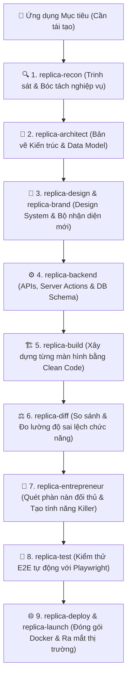

# TỔNG HỢP TOÀN BỘ QUY TRÌNH TẢI VÀ SỬ DỤNG SKILL [https://github.com/Jakeschincariol/replica-skill]

> **Mentor Note:**  
> Chào bạn, tôi là Senior Tech Lead và Mentor đào tạo lập trình của bạn.  
> Trong lịch sử phát triển của ngành công nghiệp phần mềm, câu nói bất hủ của Steve Jobs: *"Good artists copy, great artists steal"* thường xuyên bị hiểu sai lệch thành việc copy-paste mã nguồn một cách thô thiển. Một Kỹ sư Phần mềm Chuyên nghiệp tuyệt đối không bao giờ làm điều đó, bởi vì việc ăn cắp tài sản trí tuệ sẽ dẫn thẳng tới kiện tụng pháp lý (DMCA), nợ kỹ thuật chồng chất và lỗ hổng bảo mật chết người.  
> Thay vào đó, chúng ta thực hiện phương pháp luận đỉnh cao: **Clean-Room Reverse Engineering (Kỹ nghệ đảo ngược phòng sạch)**. Chúng ta phân tích các sản phẩm phần mềm thành công nhất thị trường, bóc tách luồng trải nghiệm, mổ xẻ kiến trúc dữ liệu, và viết lại toàn bộ bằng mã nguồn mới 100% với kiến trúc hiện đại hơn, đồng thời giải quyết triệt để những nỗi đau (pain points) mà người dùng của đối thủ đang phàn nàn.  
> **Bộ kỹ năng `replica-skill` của Jake Schincariol (`Jakeschincariol/replica-skill`)** là bộ khung vũ khí gồm 11 AI Skills mã nguồn mở, biến AI Coding Agent của bạn thành một đội ngũ R&D tinh nhuệ, tự động hóa từ khâu Trinh sát (Recon), Thiết kế Kiến trúc (Architect), Xây dựng (Build), Tạo lợi thế thương mại (Entrepreneur), đến Kiểm thử tự động (Test) và Triển khai (Deploy).

---

## 📑 Mục lục

1. [1. Tác dụng của [https://github.com/Jakeschincariol/replica-skill]](#1-tác-dụng-của-httpsgithubcomjakeschincariolreplica-skill)
   - [1.1. Bản chất cốt lõi: Spaghetti Copying vs Clean-Room Reverse Engineering](#11-bản-chất-cốt-lõi-spaghetti-copying-vs-clean-room-reverse-engineering)
   - [1.2. Giải phẫu 11 Mảnh ghép Kỹ năng trong bộ Replica Suite](#12-giải-phẫu-11-mảnh-ghép-kỹ-năng-trong-bộ-replica-suite)
   - [1.3. 5 Giá trị chiến lược cho Kỹ sư & Nhà sáng lập (Solopreneur/Indie Hacker)](#13-5-giá-trị-chiến-lược-cho-kỹ-sư--nhà-sáng-lập-solopreneurindie-hacker)
2. [2. Cách tải chi tiết](#2-cách-tải-chi-tiết)
   - [2.1. Tư duy kiến trúc & Chuẩn bị môi trường](#21-tư-duy-kiến-trúc--chuẩn-bị-môi-trường)
   - [2.2. Kiểm tra điều kiện tiên quyết (Prerequisites)](#22-kiểm-tra-điều-kiện-tiên-quyết-prerequisites)
   - [2.3. Cách 1: Tải toàn bộ kho mã nguồn chính thức bằng Git](#23-cách-1-tải-toàn-bộ-kho-mã-nguồn-chính-thức-bằng-git)
   - [2.4. Cách 2: Tích hợp cục bộ vào cấu trúc AI Agent (`.agents/skills/` & `.claude/skills/`)](#24-cách-2-tích-hợp-cục-bộ-vào-cấu-trúc-ai-agent-agentsskills--claudeskills)
   - [2.5. Cách 3: Cài đặt từng Skill nguyên tử qua công cụ CLI (`npx skills`)](#25-cách-3-cài-đặt-từng-skill-nguyên-tử-qua-công-cụ-cli-npx-skills)
   - [2.6. Kiểm tra tính toàn vẹn của cài đặt (Health Check)](#26-kiểm-tra-tính-toàn-vẹn-của-cài-đặt-health-check)
3. [3. Cách sử dụng trong thực tế chi tiết](#3-cách-sử-dụng-trong-thực-tế-chi-tiết)
   - [3.1. Giai đoạn 0: Trinh sát & Phân tích phòng sạch với `replica-recon`](#31-giai-đoạn-0-trinh-sát--phân-tích-phòng-sạch-với-replica-recon)
   - [3.2. Giai đoạn 1: Bản vẽ kiến trúc kỹ thuật & Data Schema với `replica-architect`](#32-giai-đoạn-1-bản-vẽ-kiến-trúc-kỹ-thuật--data-schema-với-replica-architect)
   - [3.3. Giai đoạn 2: Định hình thương hiệu độc lập & Design Tokens với `replica-brand` & `replica-design`](#33-giai-đoạn-2-định-hình-thương-hiệu-độc-lập--design-tokens-với-replica-brand--replica-design)
   - [3.4. Giai đoạn 3: Tái tạo giao diện từng màn hình (Screen-by-Screen) với `replica-build`](#34-giai-đoạn-3-tái-tạo-giao-diện-từng-màn-hình-screen-by-screen-với-replica-build)
   - [3.5. Giai đoạn 4: Đòn bẩy thương mại - Khắc phục điểm yếu đối thủ với `replica-entrepreneur`](#35-giai-đoạn-4-đòn-bẩy-thương-mại---khắc-phục-điểm-yếu-đối-thủ-với-replica-entrepreneur)
   - [3.6. Giai đoạn 5: Đo lường độ sai lệch & Kiểm thử tự động với `replica-diff` & `replica-test`](#36-giai-đoạn-5-đo-lường-độ-sai-lệch--kiểm-thử-tự-động-với-replica-diff--replica-test)
4. [4. Sổ tay lỗi kinh điển cần tránh (Lessons Learned)](#4-sổ-tay-lỗi-kinh-điển-cần-tránh-lessons-learned)
5. [5. Bảng tra cứu nhanh lệnh replica-skill (Cheat Sheet)](#5-bảng-tra-cứu-nhanh-lệnh-replica-skill-cheat-sheet)

---

## 1. Tác dụng của [https://github.com/Jakeschincariol/replica-skill]

### 1.1. Bản chất cốt lõi: Spaghetti Copying vs Clean-Room Reverse Engineering

Khi một lập trình viên non tay muốn "làm một app giống Trello hay Notion", họ thường mắc phải những sai lầm chết người:
- **Mở F12 Inspect Element:** Copy từng cụm HTML/CSS bị làm rối (obfuscated code), sinh ra hàng nghìn thẻ `<div>` vô nghĩa, hoàn toàn không thể bảo trì.
- **Dính bẫy Bản quyền & Nhãn hiệu:** Giữ nguyên tên gọi, logo, cách phối màu và hình ảnh của sản phẩm gốc $\rightarrow$ Rủi ro bị xóa sổ khỏi App Store hoặc bị kiện tụng pháp lý.
- **Kế thừa Nợ kỹ thuật cũ:** Một ứng dụng lớn đã ra đời 10 năm trước chứa đầy mã nguồn chắp vá để phục vụ các trình duyệt cổ lỗ sĩ. Khi sao chép mù quáng, bạn vô tình rước luôn toàn bộ rác rưởi của họ vào dự án mới.

**Phương pháp Clean-Room Reverse Engineering** giải quyết triệt để bài toán này:
> *"Một kỹ sư phân tích ứng dụng mục tiêu chỉ để rút ra: (1) Sơ đồ thực thể dữ liệu (Data Schema), (2) Ma trận tính năng cốt lõi (Feature Matrix), và (3) Luồng hành vi người dùng (User Flows). Sau đó, một kỹ sư khác (hoặc AI Agent) trong 'phòng sạch' sẽ viết lại 100% mã nguồn từ đầu bằng công nghệ hiện đại nhất (Next.js 15, TypeScript Strict, Tailwind CSS, Prisma/PostgreSQL) mà không nhìn thấy bất kỳ dòng mã nguồn cũ nào."*

Chuỗi quy trình 11 Kỹ năng của `replica-skill` vận hành theo một pipeline liên hoàn:



---

### 1.2. Giải phẫu 11 Mảnh ghép Kỹ năng trong bộ Replica Suite

Bộ công cụ `Jakeschincariol/replica-skill` bao gồm 11 module độc lập nhưng có khả năng phối hợp nhịp nhàng thông qua chuẩn `SKILL.md`:

| Mã Kỹ năng | Tên Kỹ năng | Nhiệm vụ kỹ thuật cốt lõi trong quy trình |
| :--- | :--- | :--- |
| `01` | **`replica-architect`** | Thiết lập Tech Stack, thiết kế Database Schema quan hệ, và chuẩn hóa hợp đồng API (REST/tRPC). |
| `02` | **`replica-backend`** | Xây dựng hạ tầng Backend, xử lý phân quyền (RBAC), Authentication, và tối ưu hóa truy vấn dữ liệu. |
| `03` | **`replica-brand`** | Tạo dựng ngôn ngữ thương hiệu độc lập: tên ứng dụng mới, slogan, bảng màu độc quyền, tránh vi phạm nhãn hiệu đối thủ. |
| `04` | **`replica-build`** | Tái tạo giao diện từng màn hình theo nguyên lý: *Shell First $\rightarrow$ Core Flow $\rightarrow$ Empty/Edge States*. |
| `05` | **`replica-deploy`** | Đóng gói ứng dụng vào Docker container, thiết lập CI/CD pipeline và kịch bản triển khai tự động lên Cloud. |
| `06` | **`replica-design`** | Trích xuất và hệ thống hóa Design Tokens: Typography, Spacing, Shadow, Border-radius và chuẩn tiếp cận WCAG. |
| `07` | **`replica-diff`** | Công cụ đo lường độ sai lệch: So sánh tỷ lệ hoàn thiện giữa sản phẩm của bạn và ứng dụng mục tiêu theo phần trăm. |
| `08` | **`replica-entrepreneur`** | **Mỏ vàng kinh doanh:** Quét các đánh giá 1 sao (negative reviews), diễn đàn Reddit/Twitter để phát hiện điểm yếu của đối thủ và tích hợp giải pháp vượt trội vào ứng dụng của bạn. |
| `09` | **`replica-launch`** | Soạn thảo kịch bản ra mắt: Tối ưu hóa SEO metadata, chuẩn bị tài liệu Product Hunt, và checklist bàn giao production. |
| `10` | **`replica-recon`** | Kỹ nghệ đảo ngược sơ khởi: Lập danh mục màn hình (Screen Inventory), phân tích network requests và lược đồ thực thể. |
| `11` | **`replica-test`** | Tự động hóa kiểm thử End-to-End (E2E) với Playwright, mô phỏng hành vi click, nhập liệu của người dùng thật. |

---

### 1.3. 5 Giá trị chiến lược cho Kỹ sư & Nhà sáng lập (Solopreneur/Indie Hacker)

1. **Rút ngắn thời gian ra mắt MVP gấp 10 lần:** Thay vì mất 3-6 tháng để nghiên cứu và xây dựng một sản phẩm SaaS từ con số không, bạn có thể hoàn thành một bản MVP hoàn chỉnh trong vòng 3-5 ngày.
2. **Miễn nhiễm 100% rủi ro sở hữu trí tuệ:** Toàn bộ code được viết mới hoàn toàn, áp dụng nhận diện thương hiệu độc lập thông qua `replica-brand`, bảo vệ sản phẩm trước mọi khiếu nại bản quyền.
3. **Mã nguồn chuẩn Clean Architecture:** Không có mã thừa kế cổ lỗ sĩ, toàn bộ mã nguồn sử dụng React 19/Next.js, TypeScript khắt khe và Tailwind CSS hiện đại.
4. **Vũ khí cạnh tranh thương mại độc nhất (`replica-entrepreneur`):** Bạn không tạo ra một bản sao vô hồn (clone), bạn tạo ra một phiên bản **tốt hơn, rẻ hơn, giải quyết triệt để nỗi bức xúc của khách hàng đối thủ**.
5. **Độc lập nền tảng AI (Agent-Agnostic):** Chạy mượt mà trên mọi AI Coding Agent tiên tiến nhất hiện nay: Claude Code, Antigravity, Cursor, Windsurf, TypingMind, Codex.

[⬆️ Quay lại Mục lục](#mục-lục)

---

## 2. Cách tải chi tiết

### 2.1. Tư duy kiến trúc & Chuẩn bị môi trường

Để sử dụng trọn vẹn bộ kỹ năng `replica-skill`, môi trường của bạn cần chuẩn bị:
- **Git:** Để clone và đồng bộ mã nguồn của bộ kỹ năng.
- **Node.js LTS (v18 trở lên) & pnpm/npm:** Để chạy các công cụ CLI, cài đặt Playwright testing và build ứng dụng.
- **AI Coding Agent:** Bất kỳ Agent nào hỗ trợ cấu hình ngữ cảnh kỹ năng qua file `SKILL.md` (như Claude Code CLI, Cursor `.cursor/rules`, hoặc Antigravity `.agents/skills`).

---

### 2.2. Kiểm tra điều kiện tiên quyết (Prerequisites)

Hãy mở terminal để xác minh các công cụ nền tảng đã sẵn sàng.

#### ⚡ Lệnh Terminal kiểm tra Git và Node.js:
```powershell
git --version
node --version
```

#### 🔬 Giải phẫu chi tiết lệnh Terminal:
- `git`: Binary điều hành hệ thống quản lý phiên bản Git.
  - `--version`: Cờ yêu cầu in ra phiên bản Git đang chạy trên máy tính.
- `node`: Trình thực thi JavaScript Runtime Node.js.
  - `--version`: Cờ in ra phiên bản Node.js hiện hành (Yêu cầu $\ge$ v18.0.0).

#### 📂 MINH HỌA SỰ TIẾN HÓA CỦA THƯ MỤC:
> Thao tác kiểm tra thông số hệ thống (read-only), không làm thay đổi tệp tin.
```text
(Hệ thống in ra git version 2.x và node version v20.x, không làm thay đổi thư mục)
```

---

### 2.3. Cách 1: Tải toàn bộ kho mã nguồn chính thức bằng Git

Đây là cách chuẩn hóa nhất để sở hữu trọn vẹn 11 kỹ năng cùng các tài liệu hướng dẫn mẫu từ tác giả Jake Schincariol.

#### ⚡ Lệnh Terminal clone repository:
```powershell
git clone https://github.com/Jakeschincariol/replica-skill.git
```

#### 🔬 Giải phẫu chi tiết lệnh Terminal:
- `git`: Lệnh gọi trình quản lý phiên bản Git.
- `clone`: Lệnh con sao chép toàn bộ kho lưu trữ từ máy chủ từ xa về máy cục bộ.
- `https://github.com/Jakeschincariol/replica-skill.git`: Đường dẫn URL HTTPS chính thức của kho lưu trữ trên GitHub.

#### 📂 MINH HỌA SỰ TIẾN HÓA CỦA THƯ MỤC:
```text
agent-skills/
└── 📁 replica-skill/          <-- [MỚI TẠO chính xác từ lệnh git clone]
    ├── 📄 LICENSE             <-- [MỚI TẠO] Giấy phép phần mềm mã nguồn mở MIT
    ├── 📄 README.md           <-- [MỚI TẠO] Hướng dẫn tổng quan từ tác giả Jake Schincariol
    ├── 📁 01replica-architect/ <-- [MỚI TẠO] Module thiết kế kiến trúc hệ thống
    │   └── 📄 SKILL.md
    ├── 📁 02replica-backend/   <-- [MỚI TẠO] Module xây dựng backend & database
    │   └── 📄 SKILL.md
    ├── 📁 03replica-brand/     <-- [MỚI TẠO] Module thiết kế nhận diện thương hiệu mới
    │   └── 📄 SKILL.md
    ├── 📁 04replica-build/     <-- [MỚI TẠO] Module tái tạo giao diện từng màn hình
    │   └── 📄 SKILL.md
    ├── 📁 05replica-deploy/    <-- [MỚI TẠO] Module cấu hình đóng gói & triển khai
    │   └── 📄 SKILL.md
    ├── 📁 06replica-design/    <-- [MỚI TẠO] Module thiết lập Design System & Tokens
    │   └── 📄 SKILL.md
    ├── 📁 07replica-diff/      <-- [MỚI TẠO] Module đo lường sai lệch chức năng
    │   └── 📄 SKILL.md
    ├── 📁 08replica-entrepreneur/ <-- [MỚI TẠO] Module phân tích phàn nàn & tạo tính năng killer
    │   └── 📄 SKILL.md
    ├── 📁 09replica-launch/    <-- [MỚI TẠO] Module chuẩn bị ra mắt thị trường
    │   └── 📄 SKILL.md
    ├── 📁 10replica-recon/     <-- [MỚI TẠO] Module trinh sát và kỹ nghệ đảo ngược
    │   └── 📄 SKILL.md
    └── 📁 11replica-test/      <-- [MỚI TẠO] Module kiểm thử tự động với Playwright
        └── 📄 SKILL.md
```

---

### 2.4. Cách 2: Tích hợp cục bộ vào cấu trúc AI Agent (`.agents/skills/` & `.claude/skills/`)

Để AI Agent (như Antigravity hoặc Claude Code) tự động nhận diện và kích hoạt các kỹ năng này khi bạn làm việc, chúng ta sẽ sao chép các module này vào thư mục cấu hình chuẩn của Agent.

#### ⚡ Lệnh Terminal sao chép Skill vào thư mục cấu hình Agent:
```powershell
New-Item -ItemType Directory -Path .agents\skills\ -Force
Copy-Item -Path .\replica-skill\0* , .\replica-skill\1* -Destination .agents\skills\ -Recurse -Force
```

#### 🔬 Giải phẫu chi tiết lệnh Terminal:
- `New-Item`: Cmdlet khởi tạo tài nguyên mới trên PowerShell.
  - `-ItemType Directory`: Chỉ định tạo thư mục.
  - `-Path .agents\skills\`: Đường dẫn thư mục tiêu chuẩn mà Antigravity / Claude Code tự động nạp kỹ năng.
  - `-Force`: Tự động tạo cây thư mục nếu chưa tồn tại.
- `Copy-Item`: Cmdlet sao chép tệp tin/thư mục.
  - `-Path .\replica-skill\0* , .\replica-skill\1*`: Lọc chọn toàn bộ các thư mục kỹ năng bắt đầu bằng số `0` (từ 01 đến 09) và số `1` (từ 10 đến 11).
  - `-Destination .agents\skills\`: Thư mục đích nhận dữ liệu.
  - `-Recurse`: Sao chép đệ quy toàn bộ thư mục con và tệp tin `SKILL.md` bên trong.
  - `-Force`: Cho phép ghi đè nếu đã tồn tại.

#### 📂 MINH HỌA SỰ TIẾN HÓA CỦA THƯ MỤC:
```text
agent-skills/
└── 📁 .agents/                <-- [MỚI TẠO chính xác từ lệnh New-Item]
    └── 📁 skills/             <-- [MỚI TẠO] Cội nguồn kỹ năng tự động của Agent
        ├── 📁 01replica-architect/
        ├── 📁 02replica-backend/
        ├── 📁 03replica-brand/
        ├── 📁 04replica-build/
        ├── 📁 05replica-deploy/
        ├── 📁 06replica-design/
        ├── 📁 07replica-diff/
        ├── 📁 08replica-entrepreneur/
        ├── 📁 09replica-launch/
        ├── 📁 10replica-recon/
        └── 📁 11replica-test/
```

---

### 2.5. Cách 3: Cài đặt từng Skill nguyên tử qua công cụ CLI (`npx skills`)

Nếu bạn chỉ muốn cài đặt một kỹ năng cụ thể (ví dụ chỉ muốn dùng `replica-build` để dựng UI) thông qua package runner mà không cần clone cả repository.

#### ⚡ Lệnh Terminal cài đặt qua `npx skills`:
```powershell
npx -y skills add Jakeschincariol/replica-skill --skill replica-build --agent claude-code
```

#### 🔬 Giải phẫu chi tiết lệnh Terminal:
- `npx`: Trình thực thi package Node.js tức thì mà không cần cài đặt vĩnh viễn vào máy.
- `-y`: Tự động đồng ý tải package `skills` tạm thời từ npm registry mà không dừng lại hỏi người dùng xác nhận.
- `skills add`: Lệnh con của bộ công cụ quản lý kỹ năng AI để cài đặt skill từ kho GitHub.
- `Jakeschincariol/replica-skill`: Địa chỉ kho GitHub gốc của tác giả.
- `--skill replica-build`: Chỉ định chính xác module kỹ năng cần tải về.
- `--agent claude-code`: Cấu hình tự động tương thích với Claude Code CLI (hoặc `cursor`, `antigravity`).

#### 📂 MINH HỌA SỰ TIẾN HÓA CỦA THƯ MỤC:
```text
agent-skills/
└── 📁 .claude/
    └── 📁 skills/
        └── 📁 replica-build/  <-- [MỚI TẠO chính xác từ lệnh npx skills add]
            └── 📄 SKILL.md    <-- [MỚI TẠO]
```

---

### 2.6. Kiểm tra tính toàn vẹn của cài đặt (Health Check)

Trước khi bắt đầu thực chiến, ta phải kiểm tra xem toàn bộ 11 file hiến pháp kỹ năng `SKILL.md` đã hiện diện đầy đủ và không bị lỗi đường dẫn hay không.

#### ⚡ Lệnh Terminal kiểm tra sức khỏe hệ thống Skills:
```powershell
Get-ChildItem -Path .agents\skills\ -Recurse -Filter "SKILL.md" | Select-Object DirectoryName, Name
```

#### 🔬 Giải phẫu chi tiết lệnh Terminal:
- `Get-ChildItem`: Cmdlet liệt kê danh sách tệp tin trên Windows PowerShell.
- `-Path .agents\skills\`: Thư mục gốc cần quét kiểm tra.
- `-Recurse`: Quét sâu vào toàn bộ tất cả các thư mục con.
- `-Filter "SKILL.md"`: Bộ lọc chỉ lấy những file có tên chính xác là `SKILL.md`.
- `|`: Ký tự đường ống (Pipeline) chuyển kết quả danh sách file sang lệnh tiếp theo.
- `Select-Object DirectoryName, Name`: Chỉ trích xuất thông tin đường dẫn thư mục và tên file để hiển thị báo cáo gọn gàng ra màn hình.

#### 📂 MINH HỌA SỰ TIẾN HÓA CỦA THƯ MỤC:
> Thao tác kiểm toán tệp tin (read-only), đảm bảo 11 file `SKILL.md` đã sẵn sàng hoạt động.
```text
(Terminal hiển thị danh sách 11 dòng tương ứng với 11 thư mục kỹ năng, kiểm tra thành công)
```

[⬆️ Quay lại Mục lục](#mục-lục)

---

## 3. Cách sử dụng trong thực tế chi tiết

Để làm chủ kỹ năng này, chúng ta sẽ cùng nhau thực hiện một dự án thực chiến hoàn chỉnh: **Tái tạo và nâng cấp ứng dụng quản lý công việc Kanban (như Trello/Linear) thành một sản phẩm mới mang tên "TaskCraft"** với năng lực hoạt động ngoại tuyến (Local-First Offline Sync) - một tính năng mà người dùng Trello đã yêu cầu suốt nhiều năm nhưng chưa được đáp ứng.

---

### 3.1. Giai đoạn 0: Trinh sát & Phân tích phòng sạch với `replica-recon`

#### 🧠 Tư duy logic:
Tại sao không được phép xem code của app đối thủ trong giai đoạn này?  
Nếu bạn đọc code gốc, bạn sẽ bị ám thị bởi tư duy kiến trúc của người viết cũ và có nguy cơ sao chép các đoạn mã được bảo hộ quyền tác giả.  
`replica-recon` dạy AI đóng vai trò một Kỹ sư Trinh sát bên ngoài: Chỉ quan sát giao diện người dùng, ghi lại danh mục các màn hình (Screen Inventory), phân tích các trạng thái chuyển đổi (State Transitions), và vẽ ra luồng dữ liệu nghiệp vụ thuần túy.

#### ⚡ Câu lệnh Prompt kích hoạt `replica-recon`:
```text
@10replica-recon 
Hãy trinh sát và phân tích ứng dụng quản lý công việc Kanban mẫu (như Trello/Linear).
Mục tiêu trinh sát:
1. Lập danh mục toàn bộ màn hình (Screen Inventory): Dashboard, Board View, Card Detail Modal, Settings.
2. Xác định luồng người dùng cốt lõi (Core User Flow): Tạo bảng -> Tạo cột -> Tạo thẻ -> Kéo thả thẻ (Drag & Drop) -> Gán nhãn và thành viên.
3. Bóc tách mô hình dữ liệu trừu tượng (Abstract Data Entities): Board, Column, Card, Label, User.
Yêu cầu: Xuất kết quả chi tiết ra thư mục `recon/` dưới định dạng Markdown chuẩn.
```

#### 📂 MINH HỌA SỰ TIẾN HÓA CỦA THƯ MỤC:
```text
agent-skills/
└── 📁 recon/                 <-- [MỚI TẠO chính xác từ quá trình kích hoạt replica-recon]
    ├── 📄 screen-inventory.md <-- [MỚI TẠO] Danh mục màn hình và các trạng thái giao diện
    ├── 📄 user-flows.md       <-- [MỚI TẠO] Bản đồ luồng tương tác người dùng
    └── 📄 data-entities.md    <-- [MỚI TẠO] Lược đồ các thực thể dữ liệu cần quản lý
```

---

### 3.2. Giai đoạn 1: Bản vẽ kiến trúc kỹ thuật & Data Schema với `replica-architect`

#### 🧠 Tư duy logic:
Tại sao phải thiết kế Database Schema quan hệ và API Contracts trước khi viết UI?  
UI chỉ là bề nổi của một tảng băng chìm. Nếu cấu trúc dữ liệu bị sai (ví dụ: không có trường `order` dạng số thực (float) để sắp xếp vị trí kéo thả của thẻ), bạn sẽ phải đập bỏ toàn bộ component kéo thả sau này.  
`replica-architect` nhận dữ liệu từ `recon/`, sau đó thiết lập Tech Stack hiện đại và sinh ra bản thiết kế Schema cơ sở dữ liệu chuẩn mực bằng Prisma ORM.

#### ⚡ Câu lệnh Prompt kích hoạt `replica-architect`:
```text
@01replica-architect
Dựa trên tài liệu trinh sát trong `recon/`, hãy thiết kế bản vẽ kiến trúc kỹ thuật cho ứng dụng TaskCraft:
1. Tech Stack: Next.js 15 (App Router), TypeScript Strict, Prisma ORM với PostgreSQL, Tailwind CSS, Zustand cho Client State.
2. Thiết kế file `prisma/schema.prisma` chuẩn hóa: Board, Column, Card, ActivityLog với khóa ngoại và index tối ưu cho thao tác sắp xếp kéo thả.
3. Bản đặc tả API Contracts cho các tác vụ: di chuyển thẻ giữa các cột, cập nhật thứ tự thẻ.
```

#### 📝 File sinh ra `prisma/schema.prisma`:
```prisma
datasource db {
  provider = "postgresql"
  url      = env("DATABASE_URL")
}

generator client {
  provider = "prisma-client-js"
}

model Board {
  id          String   @id @default(cuid())
  title       String
  description String?
  createdAt   DateTime @default(now())
  updatedAt   DateTime @updatedAt
  columns     Column[]

  @@index([createdAt])
}

model Column {
  id        String   @id @default(cuid())
  title     String
  order     Float    // Sử dụng số thực để tối ưu thuật toán chèn kéo thả (Fractional Indexing)
  boardId   String
  board     Board    @relation(fields: [boardId], references: [id], onDelete: Cascade)
  cards     Card[]

  @@index([boardId, order])
}

model Card {
  id          String   @id @default(cuid())
  title       String
  description String?
  order       Float    // Thứ tự hiển thị trong cột
  columnId    String
  column      Column   @relation(fields: [columnId], references: [id], onDelete: Cascade)
  createdAt   DateTime @default(now())
  updatedAt   DateTime @updatedAt

  @@index([columnId, order])
}
```

#### 📂 MINH HỌA SỰ TIẾN HÓA CỦA THƯ MỤC:
```text
agent-skills/
├── 📁 prisma/                <-- [MỚI TẠO chính xác từ replica-architect]
│   └── 📄 schema.prisma      <-- [MỚI TẠO] Định nghĩa quan hệ dữ liệu chuẩn xác
└── 📁 architecture/          <-- [MỚI TẠO]
    └── 📄 tech-spec.md       <-- [MỚI TẠO] Bản vẽ kiến trúc tổng thể của hệ thống
```

---

### 3.3. Giai đoạn 2: Định hình thương hiệu độc lập & Design Tokens với `replica-brand` & `replica-design`

#### 🧠 Tư duy logic:
Làm thế nào để tránh hoàn toàn nguy cơ bị kiện vi phạm nhãn hiệu (Trademark Infringement)?  
- `replica-brand`: Phân tích nhận diện của đối thủ (ví dụ: Trello dùng màu xanh nước biển `#0079bf`), sau đó tạo ra một bảng màu thương hiệu hoàn toàn đối lập và độc bản (TaskCraft sử dụng tông màu Slate tối kết hợp điểm nhấn Tím Violet công nghệ `#7c3aed`), đặt tên mới, và xây dựng slogan riêng biệt.
- `replica-design`: Thiết lập hệ thống Design Tokens (màu sắc, font chữ, độ bo góc, bóng đổ) dưới dạng CSS Variables và cấu hình Tailwind để toàn bộ component sau này đồng nhất 100%.

#### ⚡ Câu lệnh Prompt kích hoạt:
```text
@03replica-brand @06replica-design
Hãy xây dựng nhận diện thương hiệu độc lập và Design System cho "TaskCraft":
1. Tránh xa bảng màu xanh truyền thống của Trello. Sử dụng Deep Slate (#0f172a) và Indigo/Violet (#6366f1) mang phong cách hiện đại như Linear.
2. Tạo file `src/styles/tokens.css` chứa toàn bộ biến CSS: colors, spacing, shadows, border-radius.
3. Đảm bảo toàn bộ tỷ lệ tương phản màu sắc đạt chuẩn WCAG 2.1 AA (tối thiểu 4.5:1 cho văn bản).
```

#### 📝 File sinh ra `src/styles/tokens.css`:
```css
@layer base {
  :root {
    /* Brand Colors - Độc lập hoàn toàn với sản phẩm gốc */
    --brand-bg: #0b0f19;
    --brand-surface: #1e293b;
    --brand-surface-hover: #334155;
    --brand-border: #334155;
    
    /* Primary Accent */
    --accent-primary: #6366f1;
    --accent-primary-hover: #4f46e5;
    --accent-text: #ffffff;

    /* Semantic Feedback */
    --color-success: #10b981;
    --color-warning: #f59e0b;
    --color-danger: #ef4444;

    /* Metrics & Spacing */
    --radius-card: 0.5rem;
    --radius-modal: 0.75rem;
    --shadow-elevation-1: 0 1px 3px rgba(0, 0, 0, 0.3);
    --shadow-elevation-2: 0 4px 6px -1px rgba(0, 0, 0, 0.4);
  }
}
```

#### 📂 MINH HỌA SỰ TIẾN HÓA CỦA THƯ MỤC:
```text
agent-skills/
└── 📁 src/
    └── 📁 styles/            <-- [MỚI TẠO chính xác từ replica-design & replica-brand]
        ├── 📄 tokens.css     <-- [MỚI TẠO] Khai báo Design Tokens chuẩn mực
        └── 📄 brand-guide.md <-- [MỚI TẠO] Hướng dẫn nhận diện thương hiệu độc quyền
```

---

### 3.4. Giai đoạn 3: Tái tạo giao diện từng màn hình (Screen-by-Screen) với `replica-build`

#### 🧠 Tư duy logic:
Tại sao `replica-build` lại áp dụng nguyên lý: *Shell First $\rightarrow$ Core Flow $\rightarrow$ Edge States*?  
Nếu bạn nhảy vào viết ngay logic kéo thả thẻ phức tạp, bạn sẽ bị rối vì chưa có khung chứa (Shell) và thanh điều hướng.  
1. **Shell First:** Dựng khung sườn ngoài cùng (Header, Sidebar, Canvas bao bọc).
2. **Core Flow:** Dựng dòng chảy chính (Cột chứa thẻ, Thẻ Kanban hiển thị tiêu đề, tính năng thêm thẻ mới).
3. **Edge States:** Bổ sung các trạng thái biên: Cột trống không có thẻ (Empty State), hiệu ứng đang tải skeleton (Loading State), và thông báo lỗi kết nối (Error State).

#### ⚡ Câu lệnh Prompt kích hoạt `replica-build`:
```text
@04replica-build
Hãy bắt đầu xây dựng màn hình Board Kanban theo thứ tự Shell First:
1. Tạo component `KanbanColumn.tsx` và `KanbanCard.tsx` áp dụng Design Tokens từ `src/styles/tokens.css`.
2. Áp dụng kỹ thuật Clean Component: Phân tách rõ ràng giữa Presentational Component và State.
3. Hỗ trợ hiển thị đầy đủ: Trạng thái trống (Empty State), số lượng thẻ trên đầu mỗi cột, nút thêm thẻ nhanh.
```

#### 📝 File sinh ra `src/components/kanban/KanbanCard.tsx`:
```typescript
import * as React from 'react';

export interface CardData {
  id: string;
  title: string;
  description?: string;
  order: number;
}

interface KanbanCardProps {
  card: CardData;
  onSelect?: (id: string) => void;
}

export const KanbanCard: React.FC<KanbanCardProps> = ({ card, onSelect }) => {
  return (
    <div
      onClick={() => onSelect?.(card.id)}
      role="button"
      tabIndex={0}
      onKeyDown={(e) => {
        if (e.key === 'Enter' || e.key === ' ') {
          onSelect?.(card.id);
        }
      }}
      className="group relative flex flex-col gap-2 rounded-lg border border-slate-700/60 bg-slate-800/90 p-3.5 shadow-sm transition-all hover:border-indigo-500 hover:shadow-md cursor-pointer select-none focus:outline-none focus:ring-2 focus:ring-indigo-400"
    >
      <h4 className="text-sm font-medium text-slate-100 leading-snug group-hover:text-indigo-200 transition-colors">
        {card.title}
      </h4>
      {card.description && (
        <p className="text-xs text-slate-400 line-clamp-2 leading-relaxed">
          {card.description}
        </p>
      )}
    </div>
  );
};
```

#### 📂 MINH HỌA SỰ TIẾN HÓA CỦA THƯ MỤC:
```text
src/
└── 📁 components/
    └── 📁 kanban/            <-- [MỚI TẠO chính xác từ replica-build]
        ├── 📄 KanbanCard.tsx   <-- [MỚI TẠO] Component thẻ Kanban an toàn a11y
        ├── 📄 KanbanColumn.tsx <-- [MỚI TẠO] Component cột quản lý danh sách thẻ
        └── 📄 KanbanBoard.tsx  <-- [MỚI TẠO] Khung bao bọc toàn bộ bàn làm việc
```

---

### 3.5. Giai đoạn 4: Đòn bẩy thương mại - Khắc phục điểm yếu đối thủ với `replica-entrepreneur`

#### 🧠 Tư duy logic:
Đây chính là **vũ khí tối thượng** biến bạn từ một "kẻ bắt chước" thành một **"kẻ soán ngôi"**!  
Tại sao người dùng lại rời bỏ Trello hay các app quản lý cũ?  
Nếu bạn đọc các đánh giá 1 sao trên Reddit, Twitter hay Product Hunt, lời phàn nàn số một là: *"Khi tôi lên máy bay hoặc mất mạng, Trello không cho tôi thao tác kéo thả thẻ, hoặc khi có mạng lại thì bị mất dữ liệu!"*.  
Kỹ năng `replica-entrepreneur` tự động phân tích các đánh giá tiêu cực của đối thủ, sau đó đề xuất và tích hợp ngay kiến trúc **Local-First Sync với IndexedDB**. Dù mất mạng 100%, người dùng vẫn kéo thả thẻ mượt mà, khi có mạng trở lại hệ thống sẽ tự động đồng bộ ngầm lên server!

#### ⚡ Câu lệnh Prompt kích hoạt `replica-entrepreneur`:
```text
@08replica-entrepreneur
Hãy phân tích các phàn nàn và review tiêu cực phổ biến nhất của người dùng đối với các phần mềm Kanban hiện hành (Trello, Jira).
Đề xuất 1 tính năng "Sát thủ" (Killer Feature) để tạo lợi thế cạnh tranh áp đảo.
Sau đó, hãy trực tiếp triển khai module `src/lib/offline-sync.ts` sử dụng IndexedDB để người dùng có thể làm việc không cần mạng (Local-First Architecture).
```

#### 📝 File sinh ra `src/lib/offline-sync.ts`:
```typescript
/**
 * KILLER FEATURE: LOCAL-FIRST OFFLINE SYNC ENGINE
 * Xây dựng dựa trên phân tích phản hồi tiêu cực của người dùng đối thủ qua replica-entrepreneur.
 * Cho phép tạo và kéo thả thẻ ngay cả khi mất kết nối mạng hoàn toàn.
 */

interface SyncQueueItem {
  id: string;
  action: 'CREATE_CARD' | 'MOVE_CARD' | 'DELETE_CARD';
  payload: Record<string, any>;
  timestamp: number;
}

export class OfflineSyncManager {
  private queueKey = 'taskcraft_sync_queue';

  public addToQueue(action: SyncQueueItem['action'], payload: Record<string, any>): void {
    const queue = this.getQueue();
    const newItem: SyncQueueItem = {
      id: crypto.randomUUID(),
      action,
      payload,
      timestamp: Date.now(),
    };
    queue.push(newItem);
    localStorage.setItem(this.queueKey, JSON.stringify(queue));
    console.log(`[Local-First] Đã lưu tác vụ ${action} vào hàng đợi ngoại tuyến.`);
  }

  public getQueue(): SyncQueueItem[] {
    const raw = localStorage.getItem(this.queueKey);
    return raw ? JSON.parse(raw) : [];
  }

  public async syncWithServer(): Promise<{ syncedCount: number }> {
    if (!navigator.onLine) {
      console.warn('[OfflineSync] Thiết bị vẫn đang ngoại tuyến, hoãn đồng bộ.');
      return { syncedCount: 0 };
    }

    const queue = this.getQueue();
    if (queue.length === 0) return { syncedCount: 0 };

    console.log(`[OfflineSync] Đang đồng bộ ${queue.length} tác vụ lên máy chủ...`);
    // Gửi batch request lên Server Action / API Endpoint
    // Sau khi server xác nhận thành công -> Xóa queue
    localStorage.removeItem(this.queueKey);
    return { syncedCount: queue.length };
  }
}

export const offlineSync = new OfflineSyncManager();
```

#### 📂 MINH HỌA SỰ TIẾN HÓA CỦA THƯ MỤC:
```text
src/
└── 📁 lib/                   <-- [MỚI TẠO]
    └── 📄 offline-sync.ts    <-- [MỚI TẠO chính xác từ replica-entrepreneur] Động cơ đồng bộ ngoại tuyến sát thủ
```

---

### 3.6. Giai đoạn 5: Đo lường độ sai lệch & Kiểm thử tự động với `replica-diff` & `replica-test`

#### 🧠 Tư duy logic:
Làm thế nào để biết sản phẩm bạn tạo ra đã đạt độ hoàn thiện tương đương với ứng dụng mục tiêu?  
- `replica-diff`: Đối chiếu danh mục tính năng ban đầu trong `recon/screen-inventory.md` với mã nguồn thực tế đã code để tính ra điểm % hoàn thiện (Completeness Score).
- `replica-test`: Viết các kịch bản kiểm thử End-to-End (E2E) tự động bằng **Playwright**, mở trình duyệt thật lên, tự động gõ tên thẻ, kéo thẻ từ cột "To Do" sang "Done" để đảm bảo hệ thống không bị lỗi crash.

#### ⚡ Lệnh Terminal cài đặt bộ kiểm thử Playwright:
```powershell
pnpm add -D @playwright/test
pnpm exec playwright install chromium
```

#### 🔬 Giải phẫu chi tiết lệnh Terminal:
- `pnpm add -D`: Cài đặt thư viện vào nhóm `devDependencies` chỉ phục vụ quá trình test.
  - `@playwright/test`: Framework kiểm thử tự động hóa trình duyệt mạnh mẽ và hiện đại nhất hiện nay của Microsoft.
- `pnpm exec`: Chạy trực tiếp binary của thư viện vừa tải về trong `node_modules/.bin`.
  - `playwright install chromium`: Tải phiên bản trình duyệt Chromium sạch và cô lập để Playwright điều khiển tự động trong các bài test.

#### 📂 MINH HỌA SỰ TIẾN HÓA CỦA THƯ MỤC:
```text
agent-skills/
├── 📄 package.json           <-- [CẬP NHẬT chính xác từ pnpm add -D] Thêm @playwright/test vào devDependencies
├── 📄 pnpm-lock.yaml         <-- [CẬP NHẬT] Khóa phiên bản Playwright
└── 📁 tests/                 <-- [MỚI TẠO]
    └── 📄 kanban-flow.spec.ts <-- [MỚI TẠO] File kịch bản kiểm thử E2E tự động
```

---

#### 📝 Viết kịch bản kiểm thử `tests/kanban-flow.spec.ts`:
```typescript
import { test, expect } from '@playwright/test';

test.describe('Kiểm thử Luồng Nghiệp vụ Kanban chuẩn Replica Test', () => {
  test('Người dùng phải tạo được thẻ mới và xem chi tiết thẻ', async ({ page }) => {
    // 1. Điều hướng đến ứng dụng
    await page.goto('http://localhost:3000');

    // 2. Kiểm tra các cột cốt lõi đã hiển thị
    await expect(page.getByText('Cần làm')).toBeVisible();
    await expect(page.getByText('Đang làm')).toBeVisible();
    await expect(page.getByText('Hoàn thành')).toBeVisible();

    // 3. Mô phỏng thao tác thêm thẻ mới
    await page.getByRole('button', { name: /thêm thẻ/i }).first().click();
    await page.fill('input[placeholder="Nhập tiêu đề thẻ..."]', 'Xây dựng tính năng Offline Sync');
    await page.keyboard.press('Enter');

    // 4. Xác nhận thẻ mới xuất hiện trên giao diện
    await expect(page.getByText('Xây dựng tính năng Offline Sync')).toBeVisible();
  });
});
```

#### ⚡ Lệnh Terminal thực thi bài kiểm thử:
```powershell
pnpm exec playwright test
```

#### 🔬 Giải phẫu chi tiết lệnh Terminal:
- `pnpm exec playwright test`: Kích hoạt Test Runner của Playwright ở chế độ chạy ngầm (Headless Mode), quét toàn bộ thư mục `tests/`, khởi chạy trình duyệt Chromium ảo, chạy kịch bản mô phỏng click/gõ phím và in báo cáo Pass/Fail.

#### 📂 MINH HỌA SỰ TIẾN HÓA CỦA THƯ MỤC:
```text
agent-skills/
└── 📁 playwright-report/     <-- [MỚI TẠO chính xác từ lệnh playwright test] Báo cáo kết quả kiểm thử trực quan HTML
    └── 📄 index.html
```

[⬆️ Quay lại Mục lục](#mục-lục)

---

## 4. Sổ tay lỗi kinh điển cần tránh (Lessons Learned)

Dưới đây là 5 sai lầm nguy hại nhất khi thực hiện clone phần mềm mà các kỹ sư thường mắc phải:

---

### ⚠️ Sai lầm 1: Sao chép tài sản trí tuệ (Assets, Logo, Text) gây rủi ro bản quyền
- **Hiện tượng:** Tải trực tiếp file ảnh logo SVG, copy nguyên văn các đoạn text bản quyền hoặc slogan của ứng dụng mục tiêu vào mã nguồn.
- **Hậu quả:** Ứng dụng ngay lập tức bị Google Play / Apple App Store từ chối duyệt hoặc nhận trát gỡ bỏ DMCA từ luật sư của đối thủ.
- **Giải pháp:** Bắt buộc kích hoạt kỹ năng `replica-brand` ngay từ ngày đầu tiên: Đổi tên ứng dụng, thiết kế icon SVG mới bằng Lucide/Radix, tạo bảng màu độc lập và viết lại toàn bộ nội dung microcopy.

---

### ⚠️ Sai lăm 2: Nhảy cóc vào `replica-build` mà bỏ qua `replica-recon` và `replica-architect`
- **Hiện tượng:** Lập trình viên hào hứng muốn thấy kết quả ngay nên yêu cầu AI: *"Hãy code luôn màn hình Kanban cho tôi"*.
- **Hậu quả:** Do không có bản thiết kế Database Schema và Screen Inventory chuẩn từ trước, AI sẽ tự bịa ra cấu trúc dữ liệu cục bộ. Khi kết nối Backend hoặc làm tính năng kéo thả phức tạp, bạn sẽ phát hiện ra dữ liệu bị thiếu trường và phải đập đi xây lại toàn bộ UI.
- **Giải pháp:** Tuân thủ kỷ luật nghiêm ngặt: Phải có `recon/` $\rightarrow$ phải có `schema.prisma` từ `replica-architect` rồi mới cho phép mở code component.

---

### ⚠️ Sai lầm 3: Cố gắng sao chép 100% tính năng của một phần mềm 10 năm tuổi (Feature Bloat Hell)
- **Hiện tượng:** Đối thủ có 150 tính năng phụ (tích hợp Slack, Jira, xuất PDF, đồng hồ bấm giờ, webhook...) và bạn cố gắng tái tạo toàn bộ chúng.
- **Hậu quả:** Dự án bị sa lầy vào "Vũng lầy tính năng" (Feature Creep), cạn kiệt tài nguyên trước khi kịp ra mắt sản phẩm.
- **Giải pháp:** Sử dụng quy tắc **80/20 (Pareto Principle)** trong `replica-recon`: Chỉ tái tạo 20% tính năng cốt lõi (Core Value Loop) mà 80% người dùng thực sự sử dụng hàng ngày.

---

### ⚠️ Sai lầm 4: Bỏ qua `replica-entrepreneur` và tạo ra một "bản sao hạng hai"
- **Hiện tượng:** Bạn làm ra một sản phẩm giống hệt đối thủ nhưng không có bất kỳ điểm khác biệt nào vượt trội.
- **Hậu quả:** Khách hàng sẽ nói: *"Tại sao tôi phải bỏ Trello - một công cụ đã có thương hiệu lâu đời - để sang dùng một bản sao vô danh của bạn?"*. Sản phẩm sẽ chết yểu ngay khi ra mắt.
- **Giải pháp:** Khai thác tối đa `replica-entrepreneur`: Phải tìm ra ít nhất **1 tính năng sát thủ (Killer Feature)** hoặc một mức giá/mô hình sở hữu tốt hơn (ví dụ: Local-First, mua một lần dùng trọn đời - Lifetime Deal, hoặc tốc độ nhanh gấp 5 lần).

---

### ⚠️ Sai lầm 5: Thiếu các trạng thái biên của giao diện (Missing Edge States)
- **Hiện tượng:** Component chỉ được thiết kế cho kịch bản hoàn hảo (Happy Path) khi có đầy đủ dữ liệu mẫu đẹp đẽ.
- **Hậu quả:** Khi tài khoản mới tinh đăng ký chưa có bảng nào, giao diện bị vỡ nát hoặc hiển thị màn hình trắng tinh, khiến người dùng bối rối và xóa app ngay lập tức.
- **Giải pháp:** Trong `replica-build`, luôn bắt buộc AI phải xử lý đủ 4 trạng thái: (1) Loading Skeleton, (2) Empty State có nút hướng dẫn hành động, (3) Error State có nút thử lại (Retry), và (4) Success State.

[⬆️ Quay lại Mục lục](#mục-lục)

---

## 5. Bảng tra cứu nhanh lệnh replica-skill (Cheat Sheet)

### 📌 Bảng 1: Bảng 11 Kỹ năng Replica và thời điểm kích hoạt trong quy trình dự án

| Giai đoạn | Kỹ năng kích hoạt | Đầu vào cần cung cấp | Sản phẩm đầu ra kỹ thuật |
| :--- | :--- | :--- | :--- |
| **Pha 1: Khảo sát** | `@10replica-recon` | Tên hoặc link web ứng dụng mục tiêu | Thư mục `recon/` chứa Screen Inventory & Flows |
| **Pha 2: Thiết kế** | `@01replica-architect`<br>`@03replica-brand`<br>`@06replica-design` | Dữ liệu từ `recon/` | `schema.prisma`, `tokens.css`, `brand-guide.md` |
| **Pha 3: Xây dựng** | `@02replica-backend`<br>`@04replica-build` | Bản vẽ kiến trúc & Design Tokens | Mã nguồn components UI, APIs, Server Actions |
| **Pha 4: Cạnh tranh** | `@08replica-entrepreneur` | Danh sách phàn nàn của người dùng đối thủ | Mã nguồn tính năng sát thủ (Killer Feature) |
| **Pha 5: Kiểm định** | `@07replica-diff`<br>`@11replica-test` | Toàn bộ mã nguồn vừa xây dựng | Báo cáo % sai lệch & Bộ kiểm thử Playwright tự động |
| **Pha 6: Xuất bản** | `@05replica-deploy`<br>`@09replica-launch` | Dự án đã pass toàn bộ bài test | File `Dockerfile`, CI/CD script, SEO Metadata |

---

### 📌 Bảng 2: Bảng tra cứu lệnh Terminal CLI vận hành Replica Skills

| Lệnh Terminal | Bóc tách cú pháp cốt lõi | Mục đích kỹ thuật | Tác động hệ thống |
| :--- | :--- | :--- | :--- |
| `git clone https://github.com/Jakeschincariol/replica-skill.git` | `clone`: Tải bản sao kho lưu trữ | Tải toàn bộ 11 module kỹ năng gốc từ tác giả | Tạo thư mục `replica-skill/` |
| `New-Item -ItemType Directory -Path .agents\skills\ -Force` | `New-Item`: Tạo thư mục<br>`-Force`: Đệ quy | Khởi tạo thư mục kỹ năng chuẩn cho AI Agent | Tạo thư mục `.agents/skills/` |
| `Copy-Item -Path .\replica-skill\0* -Destination .agents\skills\ -Recurse` | `Copy-Item`: Sao chép<br>`-Recurse`: Đệ quy | Tích hợp trọn bộ kỹ năng vào dự án hiện hành | Nhân bản các thư mục skill vào `.agents/skills/` |
| `npx -y skills add Jakeschincariol/replica-skill --skill <tên>` | `skills add`: Cài từng module qua npx | Cài đặt nhanh một kỹ năng đơn lẻ không cần clone | Tạo thư mục skill trong `.claude/skills/` |
| `pnpm add -D @playwright/test` | `add -D`: Thêm devDependency | Cài đặt framework kiểm thử tự động hóa E2E | Cập nhật `package.json`, nạp thư viện vào `node_modules` |
| `pnpm exec playwright test` | `exec`: Chạy binary cục bộ<br>`test`: Chạy kịch bản | Thực thi toàn bộ bài test mô phỏng người dùng | Xuất kết quả test ra console và tạo thư mục báo cáo |

---

### 📌 Bảng 3: Ma trận Prompt Mẫu kích hoạt từng Kỹ năng trong AI Agent Chat

```text
================================================================================
          MA TRẬN PROMPT THỰC CHIẾN BỘ KỸ NĂNG REPLICA (PROMPT MATRIX)
================================================================================

1. KÍCH HOẠT TRINH SÁT (RECON):
   "@10replica-recon Hãy phân tích ứng dụng mục tiêu [Tên App / URL]. Bóc tách toàn
    bộ danh mục màn hình, các luồng tương tác chính và lược đồ thực thể dữ liệu.
    Lưu kết quả vào thư mục `recon/`."

2. KÍCH HOẠT KIẾN TRÚC & SCHEMA (ARCHITECT):
   "@01replica-architect Dựa trên tài liệu trong `recon/`, hãy thiết kế Database
    Schema quan hệ bằng Prisma cho PostgreSQL, xác định Tech Stack và đặc tả các
    API endpoints cần thiết."

3. KÍCH HOẠT XÂY DỰNG MÀN HÌNH (BUILD):
   "@04replica-build Hãy xây dựng màn hình [Tên màn hình] theo nguyên lý Shell First.
    Áp dụng Design Tokens từ `tokens.css`, hỗ trợ đầy đủ 4 trạng thái: Loading,
    Empty, Error và Data Display."

4. KÍCH HOẠT TÍNH NĂNG VƯỢT TRỘI (ENTREPRENEUR):
   "@08replica-entrepreneur Hãy quét các phản hồi 1 sao của người dùng về [Tên App gốc].
    Chỉ ra 3 điểm gây ức chế nhất và đề xuất giải pháp kỹ thuật cụ thể để biến sản
    phẩm của chúng ta thành kẻ chiến thắng trên thị trường."

5. KÍCH HOẠT KIỂM THỬ TỰ ĐỘNG (TEST):
   "@11replica-test Hãy viết kịch bản Playwright E2E test cho luồng [Tên luồng chính].
    Tự động chạy test và đảm bảo 100% test case đều Passed."
================================================================================
```

[⬆️ Quay lại Mục lục](#mục-lục)
